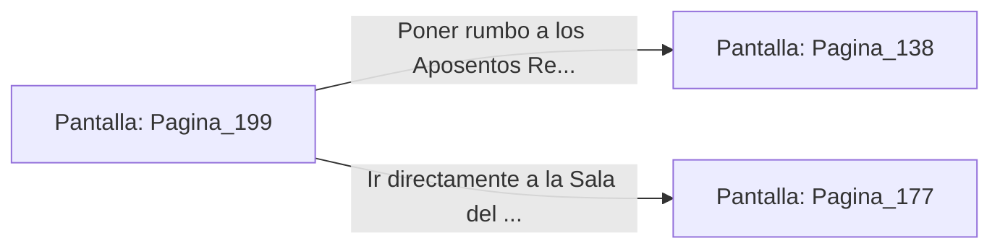

# 📺 Nodo Pantalla: `Pagina_199`

[[Index|⬅️ Índice]] | Fichero Origen: [[sample_eligejuego-code_capitulo_11_mpl|📄 sample/eligejuego-code/capitulo_11.mpl]]

**Narrativa y Encabezado:**
> PÁGINA 199: CONTAMINACIÓN DEL REFRIGERANTE
> 
> Abres la escotilla de mezcla de la bomba de éter y viertes un vial de reactivo corrosivo en el caudal principal. El fluido transparente adquiere de inmediato un tono violeta turbio mientras se distribuye por las tuberías de refrigeración.
> 
> En pocos minutos, la mezcla corrosiva comenzará a deteriorar los escudos de fase y las defensas térmicas de la Sala del Trono, debilitando la armadura de Malakor.
> 
> Con la tarea cumplida, abandonas la Sala de Máquinas por el pasadizo superior que conduce a las estancias del palacio.

## 📋 Desglose de Instrucciones de Opciones
### `OPCION "Poner rumbo a los Aposentos Reales del Palacio" CON_ACCION TRANSICIONAR_A Pagina_138`
* **Instrucción:** `OPCION` *(Manual: Mapea una entrada o botón interactivo de usuario. Vincular una acción como la invocación de una función C1, un método C2 o una transición C3.)*
* **Efecto de Control:** Dispara `TRANSICIONAR_A` hacia [[Pantalla_Pagina_138|📺 Pagina_138]]
### `OPCION "Ir directamente a la Sala del Trono a combatir a Malakor debilitado" CON_ACCION TRANSICIONAR_A Pagina_177`
* **Instrucción:** `OPCION` *(Manual: Mapea una entrada o botón interactivo de usuario. Vincular una acción como la invocación de una función C1, un método C2 o una transición C3.)*
* **Efecto de Control:** Dispara `TRANSICIONAR_A` hacia [[Pantalla_Pagina_177|📺 Pagina_177]]

## 📊 Diagrama de Flujo e Interacción (Mermaid)

