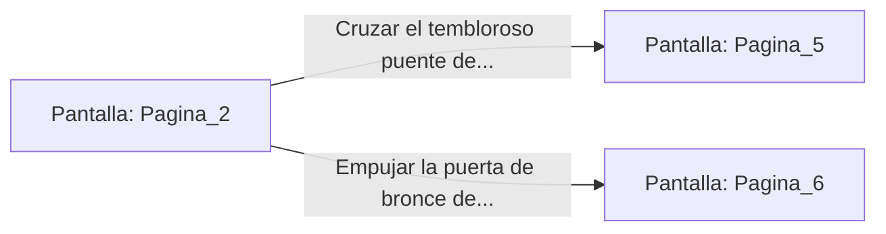

# 📺 Nodo Pantalla: `Pagina_2`

[[Index|⬅️ Índice]] | Fichero Origen: [[sample_eligejuego-code_capitulo_01_mpl|📄 sample/eligejuego-code/capitulo_01.mpl]]

**Narrativa y Encabezado:**
> PÁGINA 2: LA GALERÍA DE LAS BRUMAS
> 
> Desciendes a paso firme por la escalinata de piedra carcomida. La bruma verde no tarda en envolver tus botas, emitiendo un siseo tenue al contacto con el cuero reforzado. Con cada escalón que bajas, el zumbido del Cronoclave se vuelve más agudo, provocándote un punzante dolor detrás de las sienes.
> 
> A la mitad de la bajada, tus pies tropiezan con un relieve en el suelo. Al agacharte para inspeccionarlo, descubres un glifo de advertencia grabado por los antiguos Guardias de Aethelgard: 'Aquel que respire el aliento del Vaciadero no verá el amanecer'. Por suerte, el sistema de filtrado de tu Brazal se activa a tiempo, purificando el aire justo cuando la niebla se espesa.
> 
> Al llegar al fondo de la galería, la bruma se disipa para revelar una bifurcación natural en la caverna. A la izquierda, un estrecho puente de cordel cruza un abismo sin fondo; a la derecha, una puerta de bronce con el grabado de un escarabajo solar permanece entreabierta.

## 📋 Desglose de Instrucciones de Opciones
### `OPCION "Cruzar el tembloroso puente de cordel sobre el abismo" CON_ACCION TRANSICIONAR_A Pagina_5`
* **Instrucción:** `OPCION` *(Manual: Mapea una entrada o botón interactivo de usuario. Vincular una acción como la invocación de una función C1, un método C2 o una transición C3.)*
* **Efecto de Control:** Dispara `TRANSICIONAR_A` hacia [[Pantalla_Pagina_5|📺 Pagina_5]]
### `OPCION "Empujar la puerta de bronce del escarabajo solar" CON_ACCION TRANSICIONAR_A Pagina_6`
* **Instrucción:** `OPCION` *(Manual: Mapea una entrada o botón interactivo de usuario. Vincular una acción como la invocación de una función C1, un método C2 o una transición C3.)*
* **Efecto de Control:** Dispara `TRANSICIONAR_A` hacia [[Pantalla_Pagina_6|📺 Pagina_6]]

## 📊 Diagrama de Flujo e Interacción (Mermaid)

