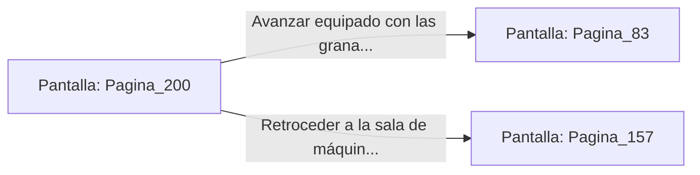

# 📺 Nodo Pantalla: `Pagina_200`

[[Index|⬅️ Índice]] | Fichero Origen: [[sample_eligejuego-code_capitulo_11_mpl|📄 sample/eligejuego-code/capitulo_11.mpl]]

**Narrativa y Encabezado:**
> PÁGINA 200: LAS CAJAS BLINDADAS DE LA GALERÍA
> 
> Abres las cajas blindadas abandonadas en el pasillo lateral mediante una descarga de tu Brazal. En su interior encuentras dos granadas de fragmentación arcana y un escáner de frecuencia militar.
> 
> Con las granadas en tu inventario, retomas el avance hacia el sector de la Fosa de los Juramentos.

## 📋 Desglose de Instrucciones de Opciones
### `OPCION "Avanzar equipado con las granadas hacia la Fosa de los Juramentos" CON_ACCION TRANSICIONAR_A Pagina_83`
* **Instrucción:** `OPCION` *(Manual: Mapea una entrada o botón interactivo de usuario. Vincular una acción como la invocación de una función C1, un método C2 o una transición C3.)*
* **Efecto de Control:** Dispara `TRANSICIONAR_A` hacia [[Pantalla_Pagina_83|📺 Pagina_83]]
### `OPCION "Retroceder a la sala de máquinas para asegurar la vía" CON_ACCION TRANSICIONAR_A Pagina_157`
* **Instrucción:** `OPCION` *(Manual: Mapea una entrada o botón interactivo de usuario. Vincular una acción como la invocación de una función C1, un método C2 o una transición C3.)*
* **Efecto de Control:** Dispara `TRANSICIONAR_A` hacia [[Pantalla_Pagina_157|📺 Pagina_157]]

## 📊 Diagrama de Flujo e Interacción (Mermaid)

