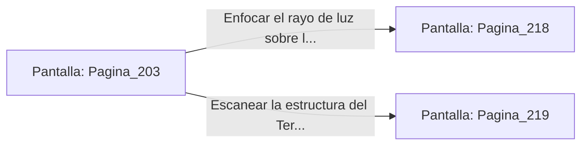

# 📺 Nodo Pantalla: `Pagina_203`

[[Index|⬅️ Índice]] | Fichero Origen: [[sample_eligejuego-code_capitulo_11_mpl|📄 sample/eligejuego-code/capitulo_11.mpl]]

**Narrativa y Encabezado:**
> PÁGINA 203: LA PLATAFORMA DEL OBSERVATORIO
> 
> Subes por la escalera exterior de hierro hasta alcanzar la plataforma elevada del Observatorio Astral. Un inmenso telescopio de lentes de cristal pulido apunta hacia la brecha espacio-temporal que flota en el cielo de Aethelgard.
> 
> Un panel de control estelar permite alterar la orientación del cristal principal del telescopio para enfocar y amplificar la luz de éter sobre cualquier sector de la ciudadela.
> 
> Puedes enfocar el rayo de luz sobre las defensas de la Sala del Trono para sobrecargarlas o usar el telescopio para escanear las debilidades del Tercer Sello.

## 📋 Desglose de Instrucciones de Opciones
### `OPCION "Enfocar el rayo de luz sobre la Sala del Trono para sobrecargar sus defensas" CON_ACCION TRANSICIONAR_A Pagina_218`
* **Instrucción:** `OPCION` *(Manual: Mapea una entrada o botón interactivo de usuario. Vincular una acción como la invocación de una función C1, un método C2 o una transición C3.)*
* **Efecto de Control:** Dispara `TRANSICIONAR_A` hacia [[Pantalla_Pagina_218|📺 Pagina_218]]
### `OPCION "Escanear la estructura del Tercer Sello de Fase con el telescopio" CON_ACCION TRANSICIONAR_A Pagina_219`
* **Instrucción:** `OPCION` *(Manual: Mapea una entrada o botón interactivo de usuario. Vincular una acción como la invocación de una función C1, un método C2 o una transición C3.)*
* **Efecto de Control:** Dispara `TRANSICIONAR_A` hacia [[Pantalla_Pagina_219|📺 Pagina_219]]

## 📊 Diagrama de Flujo e Interacción (Mermaid)

