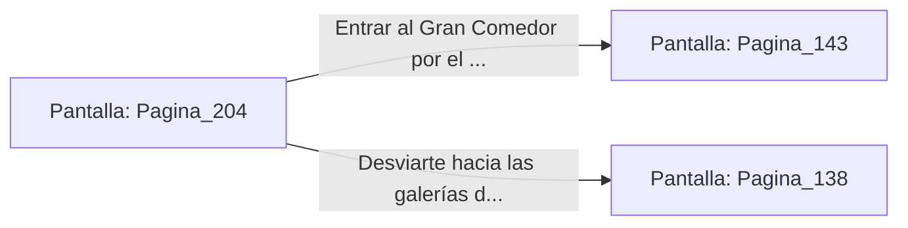

# 📺 Nodo Pantalla: `Pagina_204`

[[Index|⬅️ Índice]] | Fichero Origen: [[sample_eligejuego-code_capitulo_11_mpl|📄 sample/eligejuego-code/capitulo_11.mpl]]

**Narrativa y Encabezado:**
> PÁGINA 204: EL PASADIZO DE LOS ASTRÓNOMOS
> 
> Desciendes por la escalera de servicio privada de los astrónomos. El pasillo está decorado con cartas celestes y esferas armilares de bronce que giran impulsadas por mecanismos de relojería.
> 
> Al final de la bajada alcanzas la puerta de entrada al Gran Comedor del Palacio.

## 📋 Desglose de Instrucciones de Opciones
### `OPCION "Entrar al Gran Comedor por el pasaje de los astrónomos" CON_ACCION TRANSICIONAR_A Pagina_143`
* **Instrucción:** `OPCION` *(Manual: Mapea una entrada o botón interactivo de usuario. Vincular una acción como la invocación de una función C1, un método C2 o una transición C3.)*
* **Efecto de Control:** Dispara `TRANSICIONAR_A` hacia [[Pantalla_Pagina_143|📺 Pagina_143]]
### `OPCION "Desviarte hacia las galerías de los aposentos reales" CON_ACCION TRANSICIONAR_A Pagina_138`
* **Instrucción:** `OPCION` *(Manual: Mapea una entrada o botón interactivo de usuario. Vincular una acción como la invocación de una función C1, un método C2 o una transición C3.)*
* **Efecto de Control:** Dispara `TRANSICIONAR_A` hacia [[Pantalla_Pagina_138|📺 Pagina_138]]

## 📊 Diagrama de Flujo e Interacción (Mermaid)

