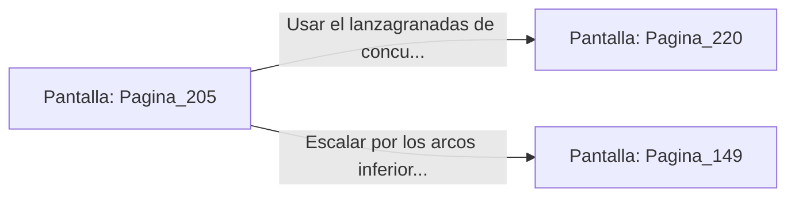

# 📺 Nodo Pantalla: `Pagina_205`

[[Index|⬅️ Índice]] | Fichero Origen: [[sample_eligejuego-code_capitulo_11_mpl|📄 sample/eligejuego-code/capitulo_11.mpl]]

**Narrativa y Encabezado:**
> PÁGINA 205: EL PUENTE DE LOS VESTIGIOS
> 
> Avanzas por el maltrecho Puente de los Vestigios que comunica el sector de los laboratorios con el complejo del palacio. La bruma del vacío abisal asciende entre las grietas de la calzada de piedra.
> 
> A mitad de camino, una patrulla de dos autómatas pesados de combate detecta tu presencia y despliega sus escudos de energía bloqueando el paso.
> 
> Puedes usar tu lanzagranadas de concusión para derribarlos al vacío o usar el sigilo para escalar por los arcos inferiores del puente.

## 📋 Desglose de Instrucciones de Opciones
### `OPCION "Usar el lanzagranadas de concusión para proyectar a los autómatas al vacío" CON_ACCION TRANSICIONAR_A Pagina_220`
* **Instrucción:** `OPCION` *(Manual: Mapea una entrada o botón interactivo de usuario. Vincular una acción como la invocación de una función C1, un método C2 o una transición C3.)*
* **Efecto de Control:** Dispara `TRANSICIONAR_A` hacia [[Pantalla_Pagina_220|📺 Pagina_220]]
### `OPCION "Escalar por los arcos inferiores del puente para sortear a la patrulla" CON_ACCION TRANSICIONAR_A Pagina_149`
* **Instrucción:** `OPCION` *(Manual: Mapea una entrada o botón interactivo de usuario. Vincular una acción como la invocación de una función C1, un método C2 o una transición C3.)*
* **Efecto de Control:** Dispara `TRANSICIONAR_A` hacia [[Pantalla_Pagina_149|📺 Pagina_149]]

## 📊 Diagrama de Flujo e Interacción (Mermaid)

