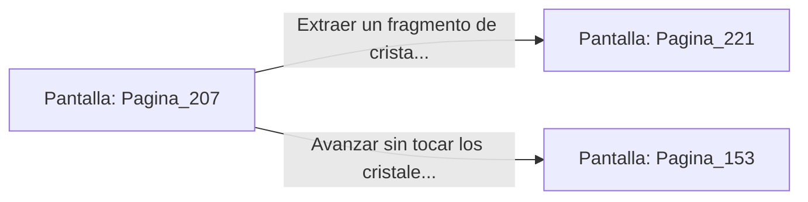

# 📺 Nodo Pantalla: `Pagina_207`

[[Index|⬅️ Índice]] | Fichero Origen: [[sample_eligejuego-code_capitulo_11_mpl|📄 sample/eligejuego-code/capitulo_11.mpl]]

**Narrativa y Encabezado:**
> PÁGINA 207: LA SALA DE CRISTALIZACIÓN
> 
> Entras en la Sala de Cristalización de Éter. Columnas de cristal translúcido crecen desde el suelo de mármol, emitiendo zumbidos armónicos que hacen vibrar el metal de tu armadura.
> 
> En el centro de la nave, una gran drusa de éter puro almacena una cantidad inmensa de energía utilizable. Con la herramienta adecuada de tu Brazal, podrías extraer un fragmento de cristal concentrado.
> 
> Tienes la opción de extraer el fragmento de cristal concentrado para potenciar tu arma o continuar por el túnel que sube a la Torre de Mando.

## 📋 Desglose de Instrucciones de Opciones
### `OPCION "Extraer un fragmento de cristal concentrado para tu armamento" CON_ACCION TRANSICIONAR_A Pagina_221`
* **Instrucción:** `OPCION` *(Manual: Mapea una entrada o botón interactivo de usuario. Vincular una acción como la invocación de una función C1, un método C2 o una transición C3.)*
* **Efecto de Control:** Dispara `TRANSICIONAR_A` hacia [[Pantalla_Pagina_221|📺 Pagina_221]]
### `OPCION "Avanzar sin tocar los cristales hacia la Torre de Mando" CON_ACCION TRANSICIONAR_A Pagina_153`
* **Instrucción:** `OPCION` *(Manual: Mapea una entrada o botón interactivo de usuario. Vincular una acción como la invocación de una función C1, un método C2 o una transición C3.)*
* **Efecto de Control:** Dispara `TRANSICIONAR_A` hacia [[Pantalla_Pagina_153|📺 Pagina_153]]

## 📊 Diagrama de Flujo e Interacción (Mermaid)

