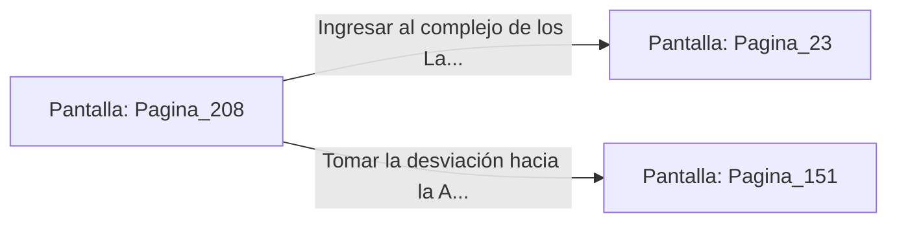

# 📺 Nodo Pantalla: `Pagina_208`

[[Index|⬅️ Índice]] | Fichero Origen: [[sample_eligejuego-code_capitulo_11_mpl|📄 sample/eligejuego-code/capitulo_11.mpl]]

**Narrativa y Encabezado:**
> PÁGINA 208: EL TÚNEL DE LOS CRISTALES
> 
> Avanzas por el túnel excavado en la drusa de cristal. El resplandor bioluminiscente de las paredes te permite prescindir de linternas tácticas durante la marcha.
> 
> Al final de la galería alcanzas una puerta blindada que da acceso al complejo de los laboratorios o al sector de la armería.

## 📋 Desglose de Instrucciones de Opciones
### `OPCION "Ingresar al complejo de los Laboratorios de Convergencia" CON_ACCION TRANSICIONAR_A Pagina_23`
* **Instrucción:** `OPCION` *(Manual: Mapea una entrada o botón interactivo de usuario. Vincular una acción como la invocación de una función C1, un método C2 o una transición C3.)*
* **Efecto de Control:** Dispara `TRANSICIONAR_A` hacia [[Pantalla_Pagina_23|📺 Pagina_23]]
### `OPCION "Tomar la desviación hacia la Armería Central" CON_ACCION TRANSICIONAR_A Pagina_151`
* **Instrucción:** `OPCION` *(Manual: Mapea una entrada o botón interactivo de usuario. Vincular una acción como la invocación de una función C1, un método C2 o una transición C3.)*
* **Efecto de Control:** Dispara `TRANSICIONAR_A` hacia [[Pantalla_Pagina_151|📺 Pagina_151]]

## 📊 Diagrama de Flujo e Interacción (Mermaid)

