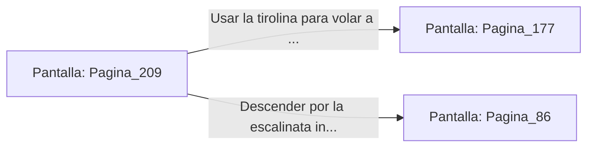

# 📺 Nodo Pantalla: `Pagina_209`

[[Index|⬅️ Índice]] | Fichero Origen: [[sample_eligejuego-code_capitulo_11_mpl|📄 sample/eligejuego-code/capitulo_11.mpl]]

**Narrativa y Encabezado:**
> PÁGINA 209: EL BALCÓN DE LA CATEDRAL
> 
> Sales al elevado Balcón de la Catedral de Aethelgard. La vista de la ciudadela subterránea desde esta altura es majestuosa: torres de granito, puentes de bronce y ríos de éter discurren bajo la tormenta violeta del techo.
> 
> Una tirolina de mantenimiento comunica el balcón directamente con la terraza exterior de la Sala del Trono de Malakor.
> 
> Puedes usar la tirolina para volar directamente a la terraza de la Sala del Trono o descender por la escalinata interior hacia la nave de la catedral.

## 📋 Desglose de Instrucciones de Opciones
### `OPCION "Usar la tirolina para volar a la terraza exterior de la Sala del Trono" CON_ACCION TRANSICIONAR_A Pagina_177`
* **Instrucción:** `OPCION` *(Manual: Mapea una entrada o botón interactivo de usuario. Vincular una acción como la invocación de una función C1, un método C2 o una transición C3.)*
* **Efecto de Control:** Dispara `TRANSICIONAR_A` hacia [[Pantalla_Pagina_177|📺 Pagina_177]]
### `OPCION "Descender por la escalinata interior hacia la nave de la Catedral" CON_ACCION TRANSICIONAR_A Pagina_86`
* **Instrucción:** `OPCION` *(Manual: Mapea una entrada o botón interactivo de usuario. Vincular una acción como la invocación de una función C1, un método C2 o una transición C3.)*
* **Efecto de Control:** Dispara `TRANSICIONAR_A` hacia [[Pantalla_Pagina_86|📺 Pagina_86]]

## 📊 Diagrama de Flujo e Interacción (Mermaid)

