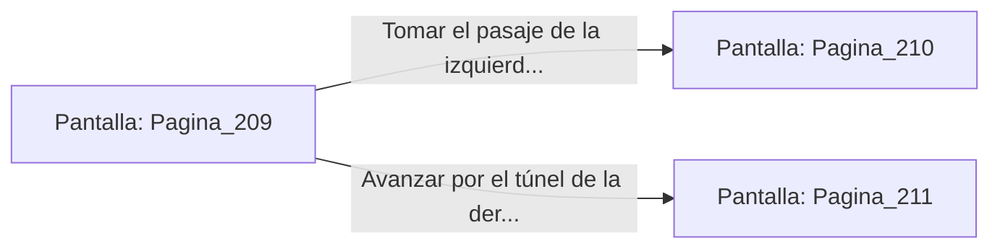

# 📺 Nodo Pantalla: `Pagina_209`

[[Index|⬅️ Índice]] | Fichero Origen: [[sample_eligejuego-code_capitulo_04_forja_almas_mpl|📄 sample/eligejuego-code/capitulo_04_forja_almas.mpl]]

**Narrativa y Encabezado:**
> Página 209: La Forja de las Almas
> 
> El calor es sofocante. Gigantescas ruedas de hierro muelen las almas atrapadas por el poder de Oscarpu. Te encuentras ante una encrucijada en la penumbra de la mazmorra. Debes tomar una decisión.

## 📋 Desglose de Instrucciones de Opciones
### `OPCION "Tomar el pasaje de la izquierda (Página 210)" CON_ACCION TRANSICIONAR_A Pagina_210`
* **Instrucción:** `OPCION` *(Manual: Mapea una entrada o botón interactivo de usuario. Vincular una acción como la invocación de una función C1, un método C2 o una transición C3.)*
* **Efecto de Control:** Dispara `TRANSICIONAR_A` hacia [[Pantalla_Pagina_210|📺 Pagina_210]]
### `OPCION "Avanzar por el túnel de la derecha (Página 211)" CON_ACCION TRANSICIONAR_A Pagina_211`
* **Instrucción:** `OPCION` *(Manual: Mapea una entrada o botón interactivo de usuario. Vincular una acción como la invocación de una función C1, un método C2 o una transición C3.)*
* **Efecto de Control:** Dispara `TRANSICIONAR_A` hacia [[Pantalla_Pagina_211|📺 Pagina_211]]

## 📊 Diagrama de Flujo e Interacción (Mermaid)

