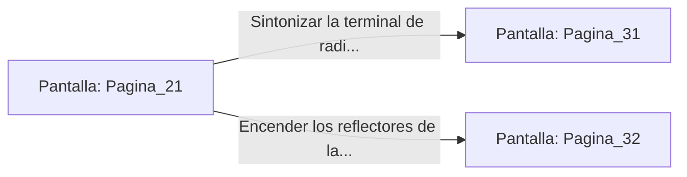

# 📺 Nodo Pantalla: `Pagina_21`

[[Index|⬅️ Índice]] | Fichero Origen: [[sample_eligejuego-code_capitulo_02_mpl|📄 sample/eligejuego-code/capitulo_02.mpl]]

**Narrativa y Encabezado:**
> PÁGINA 21: LA TORRE DE TRANSMISIÓN
> 
> Con el equipo reforzado cruzaste el puente de interconexión hasta alcanzar la Torre de Transmisión. Desde los ventanales de cristal polarizado se contempla la inmensidad de la Ciudadela Subterránea, sumida en una penumbra violeta bajo el dominio de Malakor.
> 
> Las antenas del tejado emiten impulsos de interferencia que bloquean las comunicaciones de los centinelas. Si logras calibrar la frecuencia del transmisor, podrás interceptar las órdenes de la guardia de élite.
> 
> Frente a ti hay dos consolas activas: la terminal de frecuencias de radio arcana y el interruptor maestro de los reflectores de la torre.

## 📋 Desglose de Instrucciones de Opciones
### `OPCION "Sintonizar la terminal de radio arcana para interceptar mensajes" CON_ACCION TRANSICIONAR_A Pagina_31`
* **Instrucción:** `OPCION` *(Manual: Mapea una entrada o botón interactivo de usuario. Vincular una acción como la invocación de una función C1, un método C2 o una transición C3.)*
* **Efecto de Control:** Dispara `TRANSICIONAR_A` hacia [[Pantalla_Pagina_31|📺 Pagina_31]]
### `OPCION "Encender los reflectores de la torre para cegar a los guardias del patio" CON_ACCION TRANSICIONAR_A Pagina_32`
* **Instrucción:** `OPCION` *(Manual: Mapea una entrada o botón interactivo de usuario. Vincular una acción como la invocación de una función C1, un método C2 o una transición C3.)*
* **Efecto de Control:** Dispara `TRANSICIONAR_A` hacia [[Pantalla_Pagina_32|📺 Pagina_32]]

## 📊 Diagrama de Flujo e Interacción (Mermaid)

