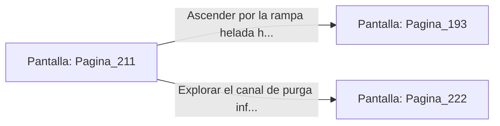

# 📺 Nodo Pantalla: `Pagina_211`

[[Index|⬅️ Índice]] | Fichero Origen: [[sample_eligejuego-code_capitulo_12_mpl|📄 sample/eligejuego-code/capitulo_12.mpl]]

**Narrativa y Encabezado:**
> PÁGINA 211: CONGELACIÓN DE LAS COMPUERTAS
> 
> Giras la llave de derivación de la Sala de Bombas e inviertes el ciclo térmico del refrigerante de éter. Un vaho helado cubre instantáneamente los tubos metálicos mientras el fluido a temperaturas bajo cero inunda los pistones de las compuertas de seguridad.
> 
> Escuchas el crujido del metal al congelarse: los cierres hidráulicos del sector quedan bloqueados por una gruesa capa de hielo escarchado, impidiendo que los refuerzos de la guardia enemiga puedan acceder al pasillo central.
> 
> Con la vía posterior totalmente sellada, debes decidir si subir hacia el Invernadero Central o explorar el canal de purga inferior.

## 📋 Desglose de Instrucciones de Opciones
### `OPCION "Ascender por la rampa helada hacia el Invernadero Central" CON_ACCION TRANSICIONAR_A Pagina_193`
* **Instrucción:** `OPCION` *(Manual: Mapea una entrada o botón interactivo de usuario. Vincular una acción como la invocación de una función C1, un método C2 o una transición C3.)*
* **Efecto de Control:** Dispara `TRANSICIONAR_A` hacia [[Pantalla_Pagina_193|📺 Pagina_193]]
### `OPCION "Explorar el canal de purga inferior de la Sala de Bombas" CON_ACCION TRANSICIONAR_A Pagina_222`
* **Instrucción:** `OPCION` *(Manual: Mapea una entrada o botón interactivo de usuario. Vincular una acción como la invocación de una función C1, un método C2 o una transición C3.)*
* **Efecto de Control:** Dispara `TRANSICIONAR_A` hacia [[Pantalla_Pagina_222|📺 Pagina_222]]

## 📊 Diagrama de Flujo e Interacción (Mermaid)

