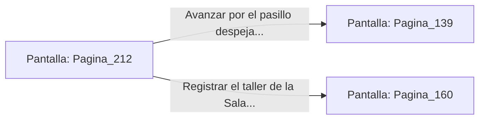

# 📺 Nodo Pantalla: `Pagina_212`

[[Index|⬅️ Índice]] | Fichero Origen: [[sample_eligejuego-code_capitulo_12_mpl|📄 sample/eligejuego-code/capitulo_12.mpl]]

**Narrativa y Encabezado:**
> PÁGINA 212: DESBORDAMIENTO EN LOS BARRACONES
> 
> Aumentas la presión de las bombas hasta forzar la ruptura de las válvulas secundarias. Una riada de refrigerante corrosivo se vierte por los conductos de ventilación directamente sobre los barracones de la guarnición enemiga.
> 
> Los gritos de alboroto y las sirenas de evacuación resuenan en la distancia mientras el contingente de la guardia se ve obligado a abandonar el sector presurosamente.

## 📋 Desglose de Instrucciones de Opciones
### `OPCION "Avanzar por el pasillo despejado hacia los Archivos Privados" CON_ACCION TRANSICIONAR_A Pagina_139`
* **Instrucción:** `OPCION` *(Manual: Mapea una entrada o botón interactivo de usuario. Vincular una acción como la invocación de una función C1, un método C2 o una transición C3.)*
* **Efecto de Control:** Dispara `TRANSICIONAR_A` hacia [[Pantalla_Pagina_139|📺 Pagina_139]]
### `OPCION "Registrar el taller de la Sala de Bombas en busca de herramientas" CON_ACCION TRANSICIONAR_A Pagina_160`
* **Instrucción:** `OPCION` *(Manual: Mapea una entrada o botón interactivo de usuario. Vincular una acción como la invocación de una función C1, un método C2 o una transición C3.)*
* **Efecto de Control:** Dispara `TRANSICIONAR_A` hacia [[Pantalla_Pagina_160|📺 Pagina_160]]

## 📊 Diagrama de Flujo e Interacción (Mermaid)

