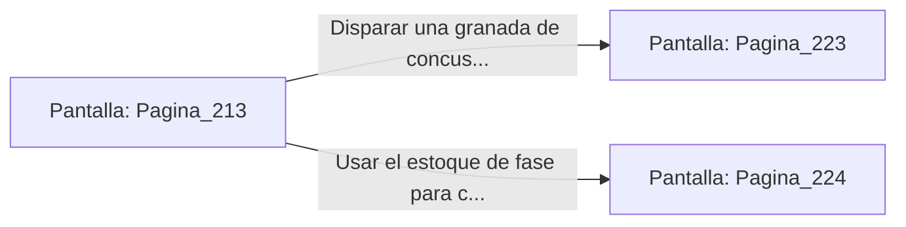

# 📺 Nodo Pantalla: `Pagina_213`

[[Index|⬅️ Índice]] | Fichero Origen: [[sample_eligejuego-code_capitulo_12_mpl|📄 sample/eligejuego-code/capitulo_12.mpl]]

**Narrativa y Encabezado:**
> PÁGINA 213: COMBATE CONTRA EL GUARDIÁN BOTÁNICO
> 
> Desenfundas tu arma de fase mientras el Guardián Botánico emerge de las aguas del estanque. Sus extremidades formadas por lianas sintéticas y placas de titanio se agitan en el aire, lanzando espinas de plasma que se clavan en el suelo de piedra.
> 
> Utilizas la cobertura de las columnas del invernadero para esquivar sus barridos mecánicos. Al analizar su patrón de ataque con tu Brazal de Convergencia, identificas que el núcleo de control de la bestia parpadea en la juntura de su tórax vegetal.
> 
> Tienes la oportunidad de disparar una granada de concusión contra su núcleo de control o usar tu estoque de fase para cortar las raíces de sustentación de sus patas.

## 📋 Desglose de Instrucciones de Opciones
### `OPCION "Disparar una granada de concusión directamente al núcleo del Guardián" CON_ACCION TRANSICIONAR_A Pagina_223`
* **Instrucción:** `OPCION` *(Manual: Mapea una entrada o botón interactivo de usuario. Vincular una acción como la invocación de una función C1, un método C2 o una transición C3.)*
* **Efecto de Control:** Dispara `TRANSICIONAR_A` hacia [[Pantalla_Pagina_223|📺 Pagina_223]]
### `OPCION "Usar el estoque de fase para cortar las raíces de sustentación" CON_ACCION TRANSICIONAR_A Pagina_224`
* **Instrucción:** `OPCION` *(Manual: Mapea una entrada o botón interactivo de usuario. Vincular una acción como la invocación de una función C1, un método C2 o una transición C3.)*
* **Efecto de Control:** Dispara `TRANSICIONAR_A` hacia [[Pantalla_Pagina_224|📺 Pagina_224]]

## 📊 Diagrama de Flujo e Interacción (Mermaid)

