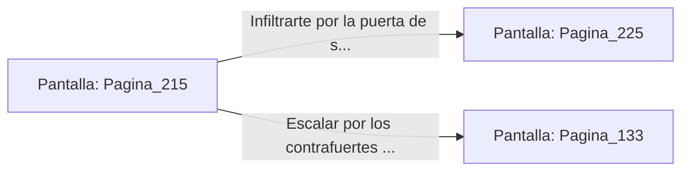

# 📺 Nodo Pantalla: `Pagina_215`

[[Index|⬅️ Índice]] | Fichero Origen: [[sample_eligejuego-code_capitulo_12_mpl|📄 sample/eligejuego-code/capitulo_12.mpl]]

**Narrativa y Encabezado:**
> PÁGINA 215: ATERRIZAJE EN LA TORRE DEL TRONO
> 
> Permaneces agazapado en la bodega de la lanzadera mientras la nave maniobra entre las turbulencias de la tormenta de éter. Pocos minutos después, el suave impacto de la plataforma confirma que la nave ha tomado tierra en el helipuerto privado de la Torre del Trono.
> 
> Esperas a que los motores se apaguen y los pilotos abandonen la nave para salir de la bodega de carga. Te encuentras en una terraza exterior rodeada de parapetos de granito desde la que se accede a los salones privados de Malakor.
> 
> Puedes colarte por la puerta de servicio del helipuerto o escalar por los contrafuertes exteriores directamente hacia el vitral de la cúpula.

## 📋 Desglose de Instrucciones de Opciones
### `OPCION "Infiltrarte por la puerta de servicio del helipuerto" CON_ACCION TRANSICIONAR_A Pagina_225`
* **Instrucción:** `OPCION` *(Manual: Mapea una entrada o botón interactivo de usuario. Vincular una acción como la invocación de una función C1, un método C2 o una transición C3.)*
* **Efecto de Control:** Dispara `TRANSICIONAR_A` hacia [[Pantalla_Pagina_225|📺 Pagina_225]]
### `OPCION "Escalar por los contrafuertes exteriores hacia el vitral de la cúpula" CON_ACCION TRANSICIONAR_A Pagina_133`
* **Instrucción:** `OPCION` *(Manual: Mapea una entrada o botón interactivo de usuario. Vincular una acción como la invocación de una función C1, un método C2 o una transición C3.)*
* **Efecto de Control:** Dispara `TRANSICIONAR_A` hacia [[Pantalla_Pagina_133|📺 Pagina_133]]

## 📊 Diagrama de Flujo e Interacción (Mermaid)

