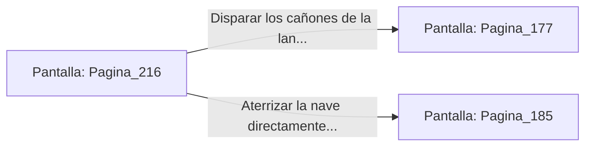

# 📺 Nodo Pantalla: `Pagina_216`

[[Index|⬅️ Índice]] | Fichero Origen: [[sample_eligejuego-code_capitulo_12_mpl|📄 sample/eligejuego-code/capitulo_12.mpl]]

**Narrativa y Encabezado:**
> PÁGINA 216: ASALTO A LA CABINA DE PILOTAJE
> 
> Irrumpes en la cabina de pilotaje desarmando al copiloto con un rápido movimiento de tu Brazal. El piloto intenta virar bruscamente la nave, pero logras tomar el control de los mandos de vuelo tras una breve brega.
> 
> Con la lanzadera bajo tu dominio, enfocas las armas de abordo contra la cúpula blindada del palacio antes de saltar en paracaídas.

## 📋 Desglose de Instrucciones de Opciones
### `OPCION "Disparar los cañones de la lanzadera contra la cúpula y saltar" CON_ACCION TRANSICIONAR_A Pagina_177`
* **Instrucción:** `OPCION` *(Manual: Mapea una entrada o botón interactivo de usuario. Vincular una acción como la invocación de una función C1, un método C2 o una transición C3.)*
* **Efecto de Control:** Dispara `TRANSICIONAR_A` hacia [[Pantalla_Pagina_177|📺 Pagina_177]]
### `OPCION "Aterrizar la nave directamente en la calzada principal del palacio" CON_ACCION TRANSICIONAR_A Pagina_185`
* **Instrucción:** `OPCION` *(Manual: Mapea una entrada o botón interactivo de usuario. Vincular una acción como la invocación de una función C1, un método C2 o una transición C3.)*
* **Efecto de Control:** Dispara `TRANSICIONAR_A` hacia [[Pantalla_Pagina_185|📺 Pagina_185]]

## 📊 Diagrama de Flujo e Interacción (Mermaid)

