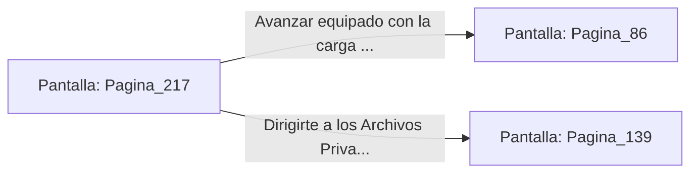

# 📺 Nodo Pantalla: `Pagina_217`

[[Index|⬅️ Índice]] | Fichero Origen: [[sample_eligejuego-code_capitulo_12_mpl|📄 sample/eligejuego-code/capitulo_12.mpl]]

**Narrativa y Encabezado:**
> PÁGINA 217: SÍNTESIS DE LA CARGA ELECTROMAGNÉTICA
> 
> Sigues las indicaciones del cuaderno alquímico en la mesa de trabajo, mezclando las sales de éter con el reactivo de mercurio rúnico. La solución burbujea en el matraz emitiendo un resplandor azulado intenso antes de estabilizarse.
> 
> Sillas la solución en un frasco electromagnético adaptable a tu lanzagranadas. Esta carga concentrada generará un pulso capaz de desactivar cualquier autómata pesado o escudo de fase en un radio de veinte metros.
> 
> Con el proyectil especial guardado en tu inventario, abandonas el laboratorio rumbo al Templo de la Convergencia o a los Archivos Privados.

## 📋 Desglose de Instrucciones de Opciones
### `OPCION "Avanzar equipado con la carga de pulso al Templo de la Convergencia" CON_ACCION TRANSICIONAR_A Pagina_86`
* **Instrucción:** `OPCION` *(Manual: Mapea una entrada o botón interactivo de usuario. Vincular una acción como la invocación de una función C1, un método C2 o una transición C3.)*
* **Efecto de Control:** Dispara `TRANSICIONAR_A` hacia [[Pantalla_Pagina_86|📺 Pagina_86]]
### `OPCION "Dirigirte a los Archivos Privados a buscar el Código de Anulación" CON_ACCION TRANSICIONAR_A Pagina_139`
* **Instrucción:** `OPCION` *(Manual: Mapea una entrada o botón interactivo de usuario. Vincular una acción como la invocación de una función C1, un método C2 o una transición C3.)*
* **Efecto de Control:** Dispara `TRANSICIONAR_A` hacia [[Pantalla_Pagina_139|📺 Pagina_139]]

## 📊 Diagrama de Flujo e Interacción (Mermaid)

