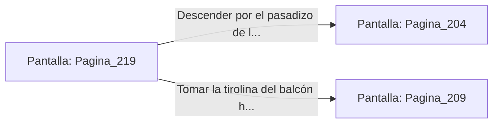

# 📺 Nodo Pantalla: `Pagina_219`

[[Index|⬅️ Índice]] | Fichero Origen: [[sample_eligejuego-code_capitulo_12_mpl|📄 sample/eligejuego-code/capitulo_12.mpl]]

**Narrativa y Encabezado:**
> PÁGINA 219: ESCANEO DEL TERCER SELLO
> 
> Ajustas las lentes del gran telescopio sobre el santuario interior de la Sala del Trono. La potente ampliación óptica de los cristales te permite analizar en detalle la estructura del Tercer Sello de Fase, fijado a la espalda del propio Malakor.
> 
> Descubres que el sello está conectado directamente al flujo vital del Inquisidor, alimentándose de las reservas de energía del Núcleo. El escaneo revela además que un golpe de frecuencia precisa sobre su pectoral desenganchará la reliquia.
> 
> Con esta valiosa información registrada en la memoria de tu Brazal, desciendes del Observatorio por la escalera del pasadizo de los astrónomos.

## 📋 Desglose de Instrucciones de Opciones
### `OPCION "Descender por el pasadizo de los astrónomos hacia el Gran Comedor" CON_ACCION TRANSICIONAR_A Pagina_204`
* **Instrucción:** `OPCION` *(Manual: Mapea una entrada o botón interactivo de usuario. Vincular una acción como la invocación de una función C1, un método C2 o una transición C3.)*
* **Efecto de Control:** Dispara `TRANSICIONAR_A` hacia [[Pantalla_Pagina_204|📺 Pagina_204]]
### `OPCION "Tomar la tirolina del balcón hacia la terraza del palacio" CON_ACCION TRANSICIONAR_A Pagina_209`
* **Instrucción:** `OPCION` *(Manual: Mapea una entrada o botón interactivo de usuario. Vincular una acción como la invocación de una función C1, un método C2 o una transición C3.)*
* **Efecto de Control:** Dispara `TRANSICIONAR_A` hacia [[Pantalla_Pagina_209|📺 Pagina_209]]

## 📊 Diagrama de Flujo e Interacción (Mermaid)

