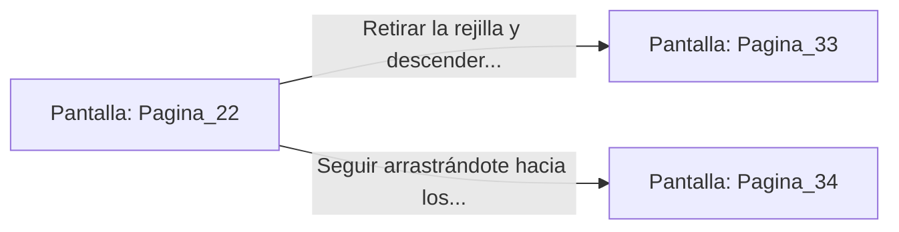

# 📺 Nodo Pantalla: `Pagina_22`

[[Index|⬅️ Índice]] | Fichero Origen: [[sample_eligejuego-code_capitulo_02_mpl|📄 sample/eligejuego-code/capitulo_02.mpl]]

**Narrativa y Encabezado:**
> PÁGINA 22: EL TÚNEL DE VENTILACIÓN
> 
> Te arrastras por el angosto conducto de chapa metálica. El polvo de siglos se pega a tu rostro y el espacio se estrecha tanto que apenas puedes mover los hombros.
> 
> Tras diez minutos de sofocante avance, llegas a una rejilla de salida que da directamente sobre el techarco del Gran Archivo.

## 📋 Desglose de Instrucciones de Opciones
### `OPCION "Retirar la rejilla y descender con cuerda al Gran Archivo" CON_ACCION TRANSICIONAR_A Pagina_33`
* **Instrucción:** `OPCION` *(Manual: Mapea una entrada o botón interactivo de usuario. Vincular una acción como la invocación de una función C1, un método C2 o una transición C3.)*
* **Efecto de Control:** Dispara `TRANSICIONAR_A` hacia [[Pantalla_Pagina_33|📺 Pagina_33]]
### `OPCION "Seguir arrastrándote hacia los laboratorios superiores" CON_ACCION TRANSICIONAR_A Pagina_34`
* **Instrucción:** `OPCION` *(Manual: Mapea una entrada o botón interactivo de usuario. Vincular una acción como la invocación de una función C1, un método C2 o una transición C3.)*
* **Efecto de Control:** Dispara `TRANSICIONAR_A` hacia [[Pantalla_Pagina_34|📺 Pagina_34]]

## 📊 Diagrama de Flujo e Interacción (Mermaid)

