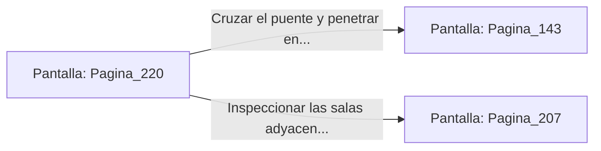

# 📺 Nodo Pantalla: `Pagina_220`

[[Index|⬅️ Índice]] | Fichero Origen: [[sample_eligejuego-code_capitulo_12_mpl|📄 sample/eligejuego-code/capitulo_12.mpl]]

**Narrativa y Encabezado:**
> PÁGINA 220: DESTRUCCIÓN EN EL PUENTE DE LOS VESTIGIOS
> 
> Alineas la mira de tu lanzagranadas de concusión y disparas contra el suelo de piedra a los pies de la patrulla de autómatas. La onda expansiva quiebra la calzada y proyecta a ambas máquinas al abismo subterráneo.
> 
> Con el camino despejado, cruzas corriendo el tramo restante del puente antes de que el vano destruido termine de colapsar.

## 📋 Desglose de Instrucciones de Opciones
### `OPCION "Cruzar el puente y penetrar en el Vestíbulo de las Columnas" CON_ACCION TRANSICIONAR_A Pagina_143`
* **Instrucción:** `OPCION` *(Manual: Mapea una entrada o botón interactivo de usuario. Vincular una acción como la invocación de una función C1, un método C2 o una transición C3.)*
* **Efecto de Control:** Dispara `TRANSICIONAR_A` hacia [[Pantalla_Pagina_143|📺 Pagina_143]]
### `OPCION "Inspeccionar las salas adyacentes al puente" CON_ACCION TRANSICIONAR_A Pagina_207`
* **Instrucción:** `OPCION` *(Manual: Mapea una entrada o botón interactivo de usuario. Vincular una acción como la invocación de una función C1, un método C2 o una transición C3.)*
* **Efecto de Control:** Dispara `TRANSICIONAR_A` hacia [[Pantalla_Pagina_207|📺 Pagina_207]]

## 📊 Diagrama de Flujo e Interacción (Mermaid)

