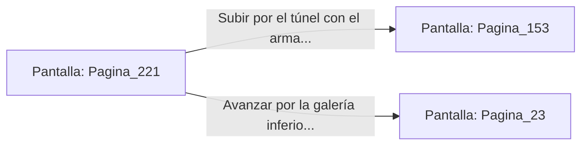

# 📺 Nodo Pantalla: `Pagina_221`

[[Index|⬅️ Índice]] | Fichero Origen: [[sample_eligejuego-code_capitulo_12_mpl|📄 sample/eligejuego-code/capitulo_12.mpl]]

**Narrativa y Encabezado:**
> PÁGINA 221: EL CRISTAL DE ÉTER CONCENTRADO
> 
> Utilizas la herramienta de corte de tu Brazal de Convergencia para extraer un fragmento puro de la gran drusa de cristal. La gema emite un calor reconfortante y una intensa vibración azulina en la palma de tu mano.
> 
> Enganchas el cristal a la cámara de energía de tu arma de fase. La potencia de disparo de tu equipo aumenta de inmediato, permitiéndote atravesar blindajes de titanio con extrema facilidad.
> 
> Equipado con el armamento mejorado, abandonas la Sala de Cristalización por el túnel que sube a la Torre de Mando.

## 📋 Desglose de Instrucciones de Opciones
### `OPCION "Subir por el túnel con el arma mejorada a la Torre de Mando" CON_ACCION TRANSICIONAR_A Pagina_153`
* **Instrucción:** `OPCION` *(Manual: Mapea una entrada o botón interactivo de usuario. Vincular una acción como la invocación de una función C1, un método C2 o una transición C3.)*
* **Efecto de Control:** Dispara `TRANSICIONAR_A` hacia [[Pantalla_Pagina_153|📺 Pagina_153]]
### `OPCION "Avanzar por la galería inferior hacia los Laboratorios" CON_ACCION TRANSICIONAR_A Pagina_23`
* **Instrucción:** `OPCION` *(Manual: Mapea una entrada o botón interactivo de usuario. Vincular una acción como la invocación de una función C1, un método C2 o una transición C3.)*
* **Efecto de Control:** Dispara `TRANSICIONAR_A` hacia [[Pantalla_Pagina_23|📺 Pagina_23]]

## 📊 Diagrama de Flujo e Interacción (Mermaid)

