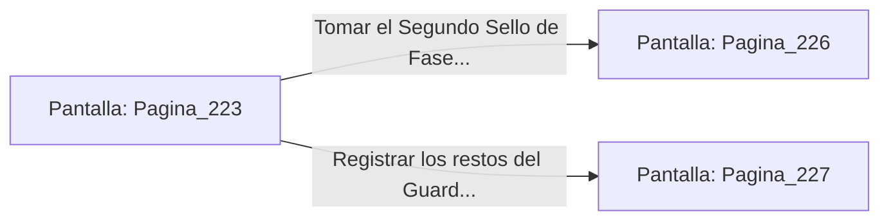

# 📺 Nodo Pantalla: `Pagina_223`

[[Index|⬅️ Índice]] | Fichero Origen: [[sample_eligejuego-code_capitulo_12_mpl|📄 sample/eligejuego-code/capitulo_12.mpl]]

**Narrativa y Encabezado:**
> PÁGINA 223: DESTRUCCIÓN DEL GUARDIÁN BOTÁNICO
> 
> Disparas la granada de concusión con precisión milimétrica hacia la juntura del tórax del Guardián Botánico. La detonación destruye el núcleo de control vegetal, provocando que la enorme bestia biomecánica colapse de rodillas sobre el estanque.
> 
> Las lianas sintéticas se marchitan instantáneamente y el domo de energía que protegía el Segundo Sello de Fase se apaga por completo.
> 
> Te aproximas al altar flotante del estanque y te apoderas del Segundo Sello de Fase, sintiendo la segunda descarga de energía rúnica en tu Brazal de Convergencia.

## 📋 Desglose de Instrucciones de Opciones
### `OPCION "Tomar el Segundo Sello de Fase y avanzar hacia los Aposentos Reales" CON_ACCION TRANSICIONAR_A Pagina_226`
* **Instrucción:** `OPCION` *(Manual: Mapea una entrada o botón interactivo de usuario. Vincular una acción como la invocación de una función C1, un método C2 o una transición C3.)*
* **Efecto de Control:** Dispara `TRANSICIONAR_A` hacia [[Pantalla_Pagina_226|📺 Pagina_226]]
### `OPCION "Registrar los restos del Guardián en busca de componentes" CON_ACCION TRANSICIONAR_A Pagina_227`
* **Instrucción:** `OPCION` *(Manual: Mapea una entrada o botón interactivo de usuario. Vincular una acción como la invocación de una función C1, un método C2 o una transición C3.)*
* **Efecto de Control:** Dispara `TRANSICIONAR_A` hacia [[Pantalla_Pagina_227|📺 Pagina_227]]

## 📊 Diagrama de Flujo e Interacción (Mermaid)

