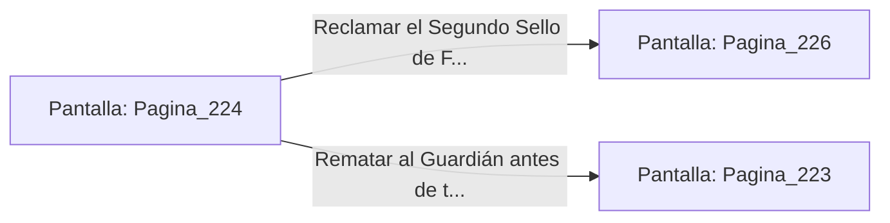

# 📺 Nodo Pantalla: `Pagina_224`

[[Index|⬅️ Índice]] | Fichero Origen: [[sample_eligejuego-code_capitulo_12_mpl|📄 sample/eligejuego-code/capitulo_12.mpl]]

**Narrativa y Encabezado:**
> PÁGINA 224: CORTE DE RAÍCES EN EL ESTANQUE
> 
> Te esquivas bajo el manotazo del Guardián y asestas una serie de estocadas rápidas con tu estoque de fase contra las raíces de sustentación de sus extremidades. El acero de luz corta la materia vegetal y el titanio con soltura, haciendo caer a la criatura al suelo de piedra.
> 
> Con el monstruo inmovilizado, te abalanzas sobre el pedestal para reclamar el Segundo Sello de Fase.

## 📋 Desglose de Instrucciones de Opciones
### `OPCION "Reclamar el Segundo Sello de Fase del pedestal" CON_ACCION TRANSICIONAR_A Pagina_226`
* **Instrucción:** `OPCION` *(Manual: Mapea una entrada o botón interactivo de usuario. Vincular una acción como la invocación de una función C1, un método C2 o una transición C3.)*
* **Efecto de Control:** Dispara `TRANSICIONAR_A` hacia [[Pantalla_Pagina_226|📺 Pagina_226]]
### `OPCION "Rematar al Guardián antes de tomar la reliquia" CON_ACCION TRANSICIONAR_A Pagina_223`
* **Instrucción:** `OPCION` *(Manual: Mapea una entrada o botón interactivo de usuario. Vincular una acción como la invocación de una función C1, un método C2 o una transición C3.)*
* **Efecto de Control:** Dispara `TRANSICIONAR_A` hacia [[Pantalla_Pagina_223|📺 Pagina_223]]

## 📊 Diagrama de Flujo e Interacción (Mermaid)

