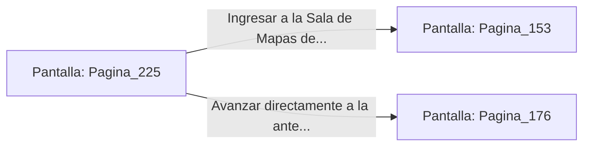

# 📺 Nodo Pantalla: `Pagina_225`

[[Index|⬅️ Índice]] | Fichero Origen: [[sample_eligejuego-code_capitulo_12_mpl|📄 sample/eligejuego-code/capitulo_12.mpl]]

**Narrativa y Encabezado:**
> PÁGINA 225: LA PUERTA DE SERVICIO DEL HELIPUERTO
> 
> Forzaste el cierre de la puerta de servicio del helipuerto usando la tarjeta de acceso de nivel tres. Te adentras en un pasillo abovedado iluminado por lámparas de cristal de éter que conduce directamente a las estancias privadas de Malakor.
> 
> Avanzas con extrema cautela escuchando las pisadas pesadas de los centinelas de la Guardia Personal en las crujías vecinas.
> 
> El pasillo se divide en dos ramales: hacia la Sala de Mapas de la Torre o hacia la antesala del Trono.

## 📋 Desglose de Instrucciones de Opciones
### `OPCION "Ingresar a la Sala de Mapas de la Torre" CON_ACCION TRANSICIONAR_A Pagina_153`
* **Instrucción:** `OPCION` *(Manual: Mapea una entrada o botón interactivo de usuario. Vincular una acción como la invocación de una función C1, un método C2 o una transición C3.)*
* **Efecto de Control:** Dispara `TRANSICIONAR_A` hacia [[Pantalla_Pagina_153|📺 Pagina_153]]
### `OPCION "Avanzar directamente a la antesala del Trono" CON_ACCION TRANSICIONAR_A Pagina_176`
* **Instrucción:** `OPCION` *(Manual: Mapea una entrada o botón interactivo de usuario. Vincular una acción como la invocación de una función C1, un método C2 o una transición C3.)*
* **Efecto de Control:** Dispara `TRANSICIONAR_A` hacia [[Pantalla_Pagina_176|📺 Pagina_176]]

## 📊 Diagrama de Flujo e Interacción (Mermaid)

