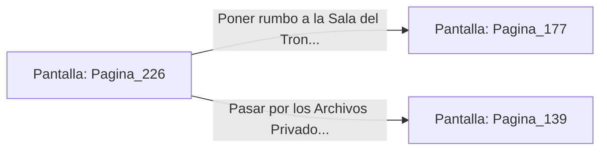

# 📺 Nodo Pantalla: `Pagina_226`

[[Index|⬅️ Índice]] | Fichero Origen: [[sample_eligejuego-code_capitulo_12_mpl|📄 sample/eligejuego-code/capitulo_12.mpl]]

**Narrativa y Encabezado:**
> PÁGINA 226: EL SEGUNDO SELLO EN TU PODER
> 
> Sujetas el Segundo Sello de Fase contra la ranura superior de tu Brazal de Convergencia. Un destello de luz esmeralda confirma la sincronización de la reliquia, fijando el segundo vector de desestabilización sobre las defensas de Malakor.
> 
> Con dos de los tres sellos en tu poder, solo resta localizar el Tercer Sello en la Sala del Trono para completar la secuencia de purificación.

## 📋 Desglose de Instrucciones de Opciones
### `OPCION "Poner rumbo a la Sala del Trono a reclamar el Tercer Sello" CON_ACCION TRANSICIONAR_A Pagina_177`
* **Instrucción:** `OPCION` *(Manual: Mapea una entrada o botón interactivo de usuario. Vincular una acción como la invocación de una función C1, un método C2 o una transición C3.)*
* **Efecto de Control:** Dispara `TRANSICIONAR_A` hacia [[Pantalla_Pagina_177|📺 Pagina_177]]
### `OPCION "Pasar por los Archivos Privados a verificar los códigos" CON_ACCION TRANSICIONAR_A Pagina_139`
* **Instrucción:** `OPCION` *(Manual: Mapea una entrada o botón interactivo de usuario. Vincular una acción como la invocación de una función C1, un método C2 o una transición C3.)*
* **Efecto de Control:** Dispara `TRANSICIONAR_A` hacia [[Pantalla_Pagina_139|📺 Pagina_139]]

## 📊 Diagrama de Flujo e Interacción (Mermaid)

