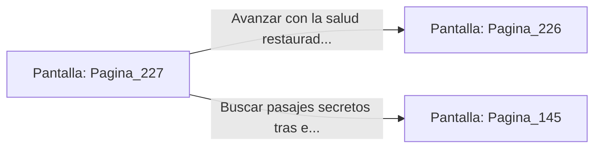

# 📺 Nodo Pantalla: `Pagina_227`

[[Index|⬅️ Índice]] | Fichero Origen: [[sample_eligejuego-code_capitulo_12_mpl|📄 sample/eligejuego-code/capitulo_12.mpl]]

**Narrativa y Encabezado:**
> PÁGINA 227: REGISTRO DE LOS RESTOS BOTÁNICOS
> 
> Te inclinas sobre los restos calcinados del Guardián Botánico e insfeccionas su tórax metálico. Entre los circuitos carbonizados encuentras un Núcleo de Energía Bioquímica intacto y una gema de enfoque óptico.
> 
> Inyectas el contenido del núcleo en tu Brazal para restaurar tu salud al cien por cien y guardas la gema de enfoque en la cartuchera militar.
> 
> Con las fuerzas recuperadas y los componentes a buen recaudo, abandonas el Invernadero Central rumbo al palacio.

## 📋 Desglose de Instrucciones de Opciones
### `OPCION "Avanzar con la salud restaurada hacia el Palacio Central" CON_ACCION TRANSICIONAR_A Pagina_226`
* **Instrucción:** `OPCION` *(Manual: Mapea una entrada o botón interactivo de usuario. Vincular una acción como la invocación de una función C1, un método C2 o una transición C3.)*
* **Efecto de Control:** Dispara `TRANSICIONAR_A` hacia [[Pantalla_Pagina_226|📺 Pagina_226]]
### `OPCION "Buscar pasajes secretos tras el estanque de savia" CON_ACCION TRANSICIONAR_A Pagina_145`
* **Instrucción:** `OPCION` *(Manual: Mapea una entrada o botón interactivo de usuario. Vincular una acción como la invocación de una función C1, un método C2 o una transición C3.)*
* **Efecto de Control:** Dispara `TRANSICIONAR_A` hacia [[Pantalla_Pagina_145|📺 Pagina_145]]

## 📊 Diagrama de Flujo e Interacción (Mermaid)

