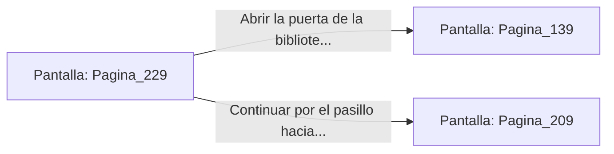

# 📺 Nodo Pantalla: `Pagina_229`

[[Index|⬅️ Índice]] | Fichero Origen: [[sample_eligejuego-code_capitulo_12_mpl|📄 sample/eligejuego-code/capitulo_12.mpl]]

**Narrativa y Encabezado:**
> PÁGINA 229: EL PASAJE DE LAS ROSAS DE CRISTAL
> 
> Avanzas por el pasadizo abovedado que bordea el invernadero, decorado con celosías de hierro y rosales de cristal bioluminiscente. El aire huele a ozono y a perfume dulce de flor arcana.
> 
> Al final de la galería encuentras una puerta de bronce con el escudo del Archimago que conduce a la biblioteca privada de Malakor.
> 
> Tienes la opción de usar tu interfaz para abrir la puerta de la biblioteca o continuar por el pasillo hacia los balcones exteriores.

## 📋 Desglose de Instrucciones de Opciones
### `OPCION "Abrir la puerta de la biblioteca privada de Malakor" CON_ACCION TRANSICIONAR_A Pagina_139`
* **Instrucción:** `OPCION` *(Manual: Mapea una entrada o botón interactivo de usuario. Vincular una acción como la invocación de una función C1, un método C2 o una transición C3.)*
* **Efecto de Control:** Dispara `TRANSICIONAR_A` hacia [[Pantalla_Pagina_139|📺 Pagina_139]]
### `OPCION "Continuar por el pasillo hacia los balcones exteriores" CON_ACCION TRANSICIONAR_A Pagina_209`
* **Instrucción:** `OPCION` *(Manual: Mapea una entrada o botón interactivo de usuario. Vincular una acción como la invocación de una función C1, un método C2 o una transición C3.)*
* **Efecto de Control:** Dispara `TRANSICIONAR_A` hacia [[Pantalla_Pagina_209|📺 Pagina_209]]

## 📊 Diagrama de Flujo e Interacción (Mermaid)

