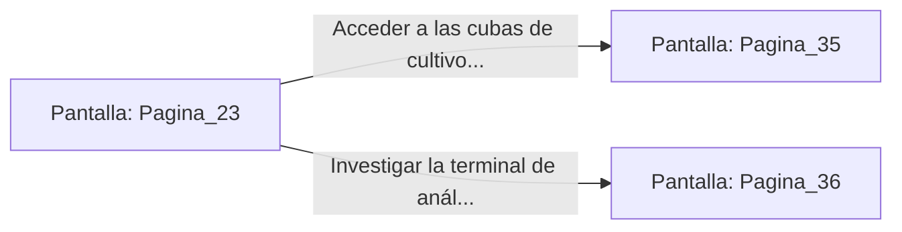

# 📺 Nodo Pantalla: `Pagina_23`

[[Index|⬅️ Índice]] | Fichero Origen: [[sample_eligejuego-code_capitulo_02_mpl|📄 sample/eligejuego-code/capitulo_02.mpl]]

**Narrativa y Encabezado:**
> PÁGINA 23: LOS LABORATORIOS DE CONVERGENCIA
> 
> Siguiendo las indicaciones del mapa grabado en la tubería, alcanzas la puerta sellada de los laboratorios. Tras validar tu firma rúnica con el Brazal, las hojas acorazadas se deslizan suavemente.

## 📋 Desglose de Instrucciones de Opciones
### `OPCION "Acceder a las cubas de cultivo sintético" CON_ACCION TRANSICIONAR_A Pagina_35`
* **Instrucción:** `OPCION` *(Manual: Mapea una entrada o botón interactivo de usuario. Vincular una acción como la invocación de una función C1, un método C2 o una transición C3.)*
* **Efecto de Control:** Dispara `TRANSICIONAR_A` hacia [[Pantalla_Pagina_35|📺 Pagina_35]]
### `OPCION "Investigar la terminal de análisis genético" CON_ACCION TRANSICIONAR_A Pagina_36`
* **Instrucción:** `OPCION` *(Manual: Mapea una entrada o botón interactivo de usuario. Vincular una acción como la invocación de una función C1, un método C2 o una transición C3.)*
* **Efecto de Control:** Dispara `TRANSICIONAR_A` hacia [[Pantalla_Pagina_36|📺 Pagina_36]]

## 📊 Diagrama de Flujo e Interacción (Mermaid)

