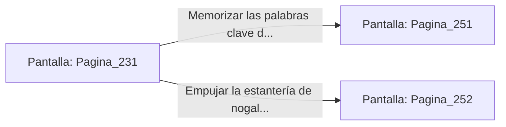

# 📺 Nodo Pantalla: `Pagina_231`

[[Index|⬅️ Índice]] | Fichero Origen: [[sample_eligejuego-code_capitulo_13_mpl|📄 sample/eligejuego-code/capitulo_13.mpl]]

**Narrativa y Encabezado:**
> PÁGINA 231: LA BIBLIOTECA PRIVADA DE MALAKOR
> 
> Cruzas el umbral de la biblioteca privada tras disipar la trampa de la puerta. Muebles de madera de nogal petrificado, atriles con tomos forrados en cuero de quimera y mapas de líneas temporales extintas cubren cada rincón de la majestuosa estancia estancia abovedada.
> 
> En el centro de la sala, sobre una mesa de lecturas de mármol negro, flota una proyección holográfica que detalla el estado actual del Núcleo de Éter y el proceso de extracción de almas ejecutado por el Inquisidor.
> 
> Junto al holograma descubres un grimorio rúnico con las palabras clave para desarmar la guardia personal de Malakor o un pasaje secreto tras una estantería.

## 📋 Desglose de Instrucciones de Opciones
### `OPCION "Memorizar las palabras clave del grimorio para desarmar a la guardia" CON_ACCION TRANSICIONAR_A Pagina_251`
* **Instrucción:** `OPCION` *(Manual: Mapea una entrada o botón interactivo de usuario. Vincular una acción como la invocación de una función C1, un método C2 o una transición C3.)*
* **Efecto de Control:** Dispara `TRANSICIONAR_A` hacia [[Pantalla_Pagina_251|📺 Pagina_251]]
### `OPCION "Empujar la estantería de nogal para acceder al pasaje secreto" CON_ACCION TRANSICIONAR_A Pagina_252`
* **Instrucción:** `OPCION` *(Manual: Mapea una entrada o botón interactivo de usuario. Vincular una acción como la invocación de una función C1, un método C2 o una transición C3.)*
* **Efecto de Control:** Dispara `TRANSICIONAR_A` hacia [[Pantalla_Pagina_252|📺 Pagina_252]]

## 📊 Diagrama de Flujo e Interacción (Mermaid)

