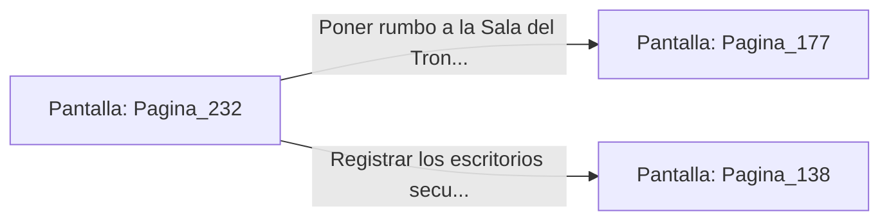

# 📺 Nodo Pantalla: `Pagina_232`

[[Index|⬅️ Índice]] | Fichero Origen: [[sample_eligejuego-code_capitulo_13_mpl|📄 sample/eligejuego-code/capitulo_13.mpl]]

**Narrativa y Encabezado:**
> PÁGINA 232: LOS ANALES DE LA DINASTÍA
> 
> Examinas los estantes superiores de los anales de Aethelgard. Encuentras un pergamino incombustible que contiene la genealogía de los antiguos reyes y una gema de recarga de salud para tu Brazal.
> 
> Absorbes la energía de la gema para asegurar tu rendimiento en combate antes de reanudar la marcha hacia la Sala del Trono.

## 📋 Desglose de Instrucciones de Opciones
### `OPCION "Poner rumbo a la Sala del Trono con las reservas a tope" CON_ACCION TRANSICIONAR_A Pagina_177`
* **Instrucción:** `OPCION` *(Manual: Mapea una entrada o botón interactivo de usuario. Vincular una acción como la invocación de una función C1, un método C2 o una transición C3.)*
* **Efecto de Control:** Dispara `TRANSICIONAR_A` hacia [[Pantalla_Pagina_177|📺 Pagina_177]]
### `OPCION "Registrar los escritorios secundarios en busca de más reliquias" CON_ACCION TRANSICIONAR_A Pagina_138`
* **Instrucción:** `OPCION` *(Manual: Mapea una entrada o botón interactivo de usuario. Vincular una acción como la invocación de una función C1, un método C2 o una transición C3.)*
* **Efecto de Control:** Dispara `TRANSICIONAR_A` hacia [[Pantalla_Pagina_138|📺 Pagina_138]]

## 📊 Diagrama de Flujo e Interacción (Mermaid)

