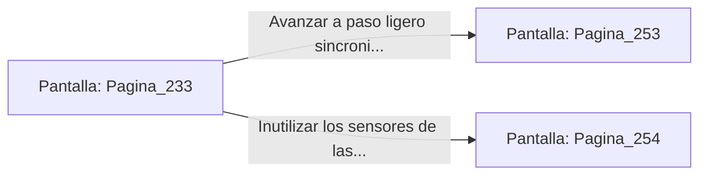

# 📺 Nodo Pantalla: `Pagina_233`

[[Index|⬅️ Índice]] | Fichero Origen: [[sample_eligejuego-code_capitulo_13_mpl|📄 sample/eligejuego-code/capitulo_13.mpl]]

**Narrativa y Encabezado:**
> PÁGINA 233: EL PASILLO DE LAS ESTATUAS PARPADEANTES
> 
> Te internas por un pasadizo flanqueado por estatuas de bronce que representan a los antiguos archimagos de la ciudadela. Sus ojos de cristal emiten un leve parpadeo bioluminiscente al detectar la firma de energía de tu Brazal de Convergencia.
> 
> Sientes que cada estatua actúa como un repetidor de escaneo cinético para la red central del palacio. Un movimiento en falso o una pausa prolongada activará el sistema defensivo automático de la galería.
> 
> Tienes la opción de avanzar a paso ligero calculando los intervalos del parpadeo u ocultarte tras los pedestales para inutilizar los sensores con tu herramienta rúnica.

## 📋 Desglose de Instrucciones de Opciones
### `OPCION "Avanzar a paso ligero sincronizándote con los intervalos del parpadeo" CON_ACCION TRANSICIONAR_A Pagina_253`
* **Instrucción:** `OPCION` *(Manual: Mapea una entrada o botón interactivo de usuario. Vincular una acción como la invocación de una función C1, un método C2 o una transición C3.)*
* **Efecto de Control:** Dispara `TRANSICIONAR_A` hacia [[Pantalla_Pagina_253|📺 Pagina_253]]
### `OPCION "Inutilizar los sensores de las estatuas con tu herramienta rúnica" CON_ACCION TRANSICIONAR_A Pagina_254`
* **Instrucción:** `OPCION` *(Manual: Mapea una entrada o botón interactivo de usuario. Vincular una acción como la invocación de una función C1, un método C2 o una transición C3.)*
* **Efecto de Control:** Dispara `TRANSICIONAR_A` hacia [[Pantalla_Pagina_254|📺 Pagina_254]]

## 📊 Diagrama de Flujo e Interacción (Mermaid)

