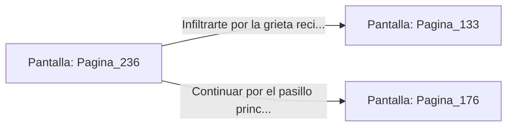

# 📺 Nodo Pantalla: `Pagina_236`

[[Index|⬅️ Índice]] | Fichero Origen: [[sample_eligejuego-code_capitulo_13_mpl|📄 sample/eligejuego-code/capitulo_13.mpl]]

**Narrativa y Encabezado:**
> PÁGINA 236: LA CONSOLA DE LAS CADENAS
> 
> Accedes a la consola de control y alteras el equilibrio de los contrapesos de las cadenas. El gigantesco diapasón emite un chirrido agudo antes de inclinar su estructura hacia la pared izquierda.
> 
> La sacudida provoca una grieta en la mampostería por la que se atisba un pasaje de mantenimiento directo al nivel de la cúpula.

## 📋 Desglose de Instrucciones de Opciones
### `OPCION "Infiltrarte por la grieta recién abierta hacia la cúpula" CON_ACCION TRANSICIONAR_A Pagina_133`
* **Instrucción:** `OPCION` *(Manual: Mapea una entrada o botón interactivo de usuario. Vincular una acción como la invocación de una función C1, un método C2 o una transición C3.)*
* **Efecto de Control:** Dispara `TRANSICIONAR_A` hacia [[Pantalla_Pagina_133|📺 Pagina_133]]
### `OPCION "Continuar por el pasillo principal hacia la Antesala del Trono" CON_ACCION TRANSICIONAR_A Pagina_176`
* **Instrucción:** `OPCION` *(Manual: Mapea una entrada o botón interactivo de usuario. Vincular una acción como la invocación de una función C1, un método C2 o una transición C3.)*
* **Efecto de Control:** Dispara `TRANSICIONAR_A` hacia [[Pantalla_Pagina_176|📺 Pagina_176]]

## 📊 Diagrama de Flujo e Interacción (Mermaid)

