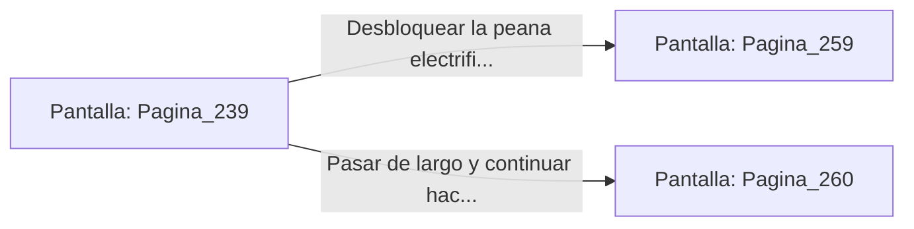

# 📺 Nodo Pantalla: `Pagina_239`

[[Index|⬅️ Índice]] | Fichero Origen: [[sample_eligejuego-code_capitulo_13_mpl|📄 sample/eligejuego-code/capitulo_13.mpl]]

**Narrativa y Encabezado:**
> PÁGINA 239: EL ARSENAL PRIVADO DE MALAKOR
> 
> Entras en el arsenal privado del Inquisidor. A diferencia de las armerías comunes, aquí reposan armas conceptuales de alta tecnología creadas por el propio Malakor para doblegar las líneas temporales.
> 
> En una peana electrificada brilla un Rifle de Pulso Cronal y un Escudo Deflector de Inducción. Ambos artefactos están conectados al sistema de energía del palacio.
> 
> Decides si usar tu Brazal de Convergencia para desbloquear la seguridad de la peana y reclamar las armas o pasar de largo para evitar llamar la atención del sistema.

## 📋 Desglose de Instrucciones de Opciones
### `OPCION "Desbloquear la peana electrificada para apoderarte del Rifle Cronal" CON_ACCION TRANSICIONAR_A Pagina_259`
* **Instrucción:** `OPCION` *(Manual: Mapea una entrada o botón interactivo de usuario. Vincular una acción como la invocación de una función C1, un método C2 o una transición C3.)*
* **Efecto de Control:** Dispara `TRANSICIONAR_A` hacia [[Pantalla_Pagina_259|📺 Pagina_259]]
### `OPCION "Pasar de largo y continuar hacia el Salón del Consejo" CON_ACCION TRANSICIONAR_A Pagina_260`
* **Instrucción:** `OPCION` *(Manual: Mapea una entrada o botón interactivo de usuario. Vincular una acción como la invocación de una función C1, un método C2 o una transición C3.)*
* **Efecto de Control:** Dispara `TRANSICIONAR_A` hacia [[Pantalla_Pagina_260|📺 Pagina_260]]

## 📊 Diagrama de Flujo e Interacción (Mermaid)

