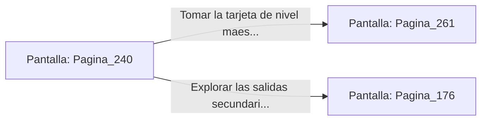

# 📺 Nodo Pantalla: `Pagina_240`

[[Index|⬅️ Índice]] | Fichero Origen: [[sample_eligejuego-code_capitulo_13_mpl|📄 sample/eligejuego-code/capitulo_13.mpl]]

**Narrativa y Encabezado:**
> PÁGINA 240: EL SALÓN DEL CONSEJO
> 
> Atraviesas el Salón del Consejo de Aethelgard. Inmensas sillas de piedra dispuestas en semicírculo rodean una mesa holográfica donde se proyecta la mapa del Imperio en ruinas.
> 
> En el centro del tablero holográfico brilla la tarjeta de nivel maestro que abre los aposentos personales del Inquisidor.

## 📋 Desglose de Instrucciones de Opciones
### `OPCION "Tomar la tarjeta de nivel maestro e ir a los aposentos personales" CON_ACCION TRANSICIONAR_A Pagina_261`
* **Instrucción:** `OPCION` *(Manual: Mapea una entrada o botón interactivo de usuario. Vincular una acción como la invocación de una función C1, un método C2 o una transición C3.)*
* **Efecto de Control:** Dispara `TRANSICIONAR_A` hacia [[Pantalla_Pagina_261|📺 Pagina_261]]
### `OPCION "Explorar las salidas secundarias del Salón del Consejo" CON_ACCION TRANSICIONAR_A Pagina_176`
* **Instrucción:** `OPCION` *(Manual: Mapea una entrada o botón interactivo de usuario. Vincular una acción como la invocación de una función C1, un método C2 o una transición C3.)*
* **Efecto de Control:** Dispara `TRANSICIONAR_A` hacia [[Pantalla_Pagina_176|📺 Pagina_176]]

## 📊 Diagrama de Flujo e Interacción (Mermaid)

