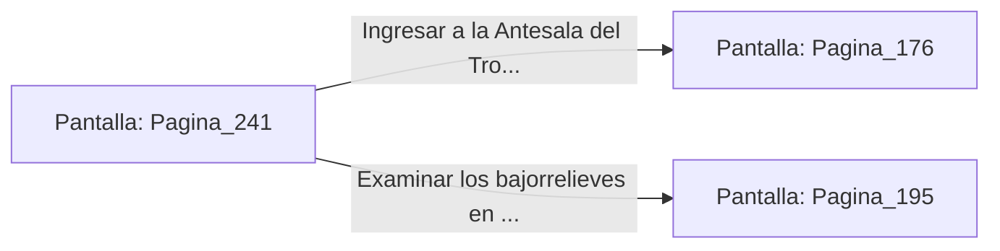

# 📺 Nodo Pantalla: `Pagina_241`

[[Index|⬅️ Índice]] | Fichero Origen: [[sample_eligejuego-code_capitulo_13_mpl|📄 sample/eligejuego-code/capitulo_13.mpl]]

**Narrativa y Encabezado:**
> PÁGINA 241: LA GALERÍA DE LOS REYES MÁRTIRES
> 
> Avanzas por un pasadizo abovedado iluminado por pecheras de cristal de éter. Bajorrelieves tallados en mármol blanco narran las vidas y sacrificios de los antiguos monarcas que gobernaron la ciudadela antes del colapso.
> 
> En un nicho destacado al final de la galería descansa la Cuerda de Escape de Titanio y un botiquín con tres dosis de tónico curativo concentrado.
> 
> Te equipas con la cuerda de titanio y guardas los viales médicos en tu inventario antes de tomar la puerta que da acceso a la Antesala del Trono.

## 📋 Desglose de Instrucciones de Opciones
### `OPCION "Ingresar a la Antesala del Trono con los pertrechos médicos" CON_ACCION TRANSICIONAR_A Pagina_176`
* **Instrucción:** `OPCION` *(Manual: Mapea una entrada o botón interactivo de usuario. Vincular una acción como la invocación de una función C1, un método C2 o una transición C3.)*
* **Efecto de Control:** Dispara `TRANSICIONAR_A` hacia [[Pantalla_Pagina_176|📺 Pagina_176]]
### `OPCION "Examinar los bajorrelieves en busca de pasajes ocultos" CON_ACCION TRANSICIONAR_A Pagina_195`
* **Instrucción:** `OPCION` *(Manual: Mapea una entrada o botón interactivo de usuario. Vincular una acción como la invocación de una función C1, un método C2 o una transición C3.)*
* **Efecto de Control:** Dispara `TRANSICIONAR_A` hacia [[Pantalla_Pagina_195|📺 Pagina_195]]

## 📊 Diagrama de Flujo e Interacción (Mermaid)

