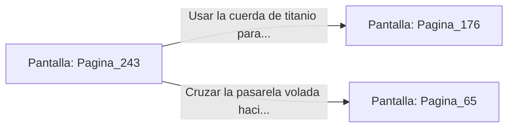

# 📺 Nodo Pantalla: `Pagina_243`

[[Index|⬅️ Índice]] | Fichero Origen: [[sample_eligejuego-code_capitulo_13_mpl|📄 sample/eligejuego-code/capitulo_13.mpl]]

**Narrativa y Encabezado:**
> PÁGINA 243: LOS MIRADORES DE LA TORRE
> 
> Sales a las terrazas voladas que bordean la cima de la Torre del Trono. El viento abisal ruge con fuerza glacial mientras la tormenta de éter azota las agujas de granito con relámpagos esmeralda y violeta.
> 
> Desde esta altura divisas la estructura de la cúpula blindada y las pasarelas que conectan con los generadores secundarios de la fortificación.
> 
> Puedes usar tu cuerda de titanio para descender directamente al balcón principal de la Sala del Trono o cruzar la pasarela hacia los generadores.

## 📋 Desglose de Instrucciones de Opciones
### `OPCION "Usar la cuerda de titanio para descender al balcón del Trono" CON_ACCION TRANSICIONAR_A Pagina_176`
* **Instrucción:** `OPCION` *(Manual: Mapea una entrada o botón interactivo de usuario. Vincular una acción como la invocación de una función C1, un método C2 o una transición C3.)*
* **Efecto de Control:** Dispara `TRANSICIONAR_A` hacia [[Pantalla_Pagina_176|📺 Pagina_176]]
### `OPCION "Cruzar la pasarela volada hacia los generadores secundarios" CON_ACCION TRANSICIONAR_A Pagina_65`
* **Instrucción:** `OPCION` *(Manual: Mapea una entrada o botón interactivo de usuario. Vincular una acción como la invocación de una función C1, un método C2 o una transición C3.)*
* **Efecto de Control:** Dispara `TRANSICIONAR_A` hacia [[Pantalla_Pagina_65|📺 Pagina_65]]

## 📊 Diagrama de Flujo e Interacción (Mermaid)

