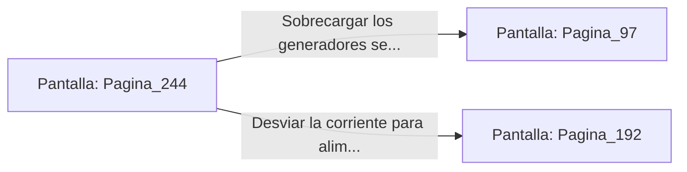

# 📺 Nodo Pantalla: `Pagina_244`

[[Index|⬅️ Índice]] | Fichero Origen: [[sample_eligejuego-code_capitulo_13_mpl|📄 sample/eligejuego-code/capitulo_13.mpl]]

**Narrativa y Encabezado:**
> PÁGINA 244: LA PASARELA DE LOS GENERADORES SECUNDARIOS
> 
> Cruzas la estructura metálica sobre el abismo procurando no hacer movimientos bruscos que alteren tu equilibrio bajo las ráfagas del viento abisal.
> 
> Alcanzas la sala de los generadores secundarios justo cuando el panel principal emite un pitido de sobrecarga de energía.

## 📋 Desglose de Instrucciones de Opciones
### `OPCION "Sobrecargar los generadores secundarios para desactivar los escudos" CON_ACCION TRANSICIONAR_A Pagina_97`
* **Instrucción:** `OPCION` *(Manual: Mapea una entrada o botón interactivo de usuario. Vincular una acción como la invocación de una función C1, un método C2 o una transición C3.)*
* **Efecto de Control:** Dispara `TRANSICIONAR_A` hacia [[Pantalla_Pagina_97|📺 Pagina_97]]
### `OPCION "Desviar la corriente para alimentar las defensas de tu Brazal" CON_ACCION TRANSICIONAR_A Pagina_192`
* **Instrucción:** `OPCION` *(Manual: Mapea una entrada o botón interactivo de usuario. Vincular una acción como la invocación de una función C1, un método C2 o una transición C3.)*
* **Efecto de Control:** Dispara `TRANSICIONAR_A` hacia [[Pantalla_Pagina_192|📺 Pagina_192]]

## 📊 Diagrama de Flujo e Interacción (Mermaid)

