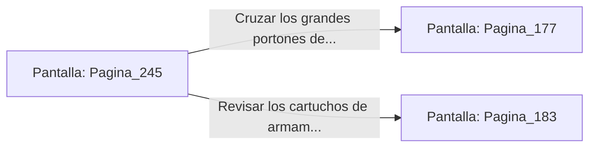

# 📺 Nodo Pantalla: `Pagina_245`

[[Index|⬅️ Índice]] | Fichero Origen: [[sample_eligejuego-code_capitulo_13_mpl|📄 sample/eligejuego-code/capitulo_13.mpl]]

**Narrativa y Encabezado:**
> PÁGINA 245: EL SANTUARIO DE LA CONVERGENCIA FINAL
> 
> Llegas a la bóveda previa a la Sala del Trono. En el centro de la sala, sobre una peana de obsidiana, flota un prisma cristalino que concentra las frecuencias del Primer y Segundo Sello de Fase que has recolectado.
> 
> Tu Brazal de Convergencia reacciona con intensidad, absorbiendo la energía del prisma y cargando al cien por cien la secuencia de purificación para el enfrentamiento definitivo.
> 
> Con todas tus capacidades potenciadas y los dos sellos sincronizados, te encuentras frente a los grandes portones de bronce que conducen al trono de Malakor.

## 📋 Desglose de Instrucciones de Opciones
### `OPCION "Cruzar los grandes portones de bronce y enfrentar a Malakor" CON_ACCION TRANSICIONAR_A Pagina_177`
* **Instrucción:** `OPCION` *(Manual: Mapea una entrada o botón interactivo de usuario. Vincular una acción como la invocación de una función C1, un método C2 o una transición C3.)*
* **Efecto de Control:** Dispara `TRANSICIONAR_A` hacia [[Pantalla_Pagina_177|📺 Pagina_177]]
### `OPCION "Revisar los cartuchos de armamento antes de la batalla final" CON_ACCION TRANSICIONAR_A Pagina_183`
* **Instrucción:** `OPCION` *(Manual: Mapea una entrada o botón interactivo de usuario. Vincular una acción como la invocación de una función C1, un método C2 o una transición C3.)*
* **Efecto de Control:** Dispara `TRANSICIONAR_A` hacia [[Pantalla_Pagina_183|📺 Pagina_183]]

## 📊 Diagrama de Flujo e Interacción (Mermaid)

