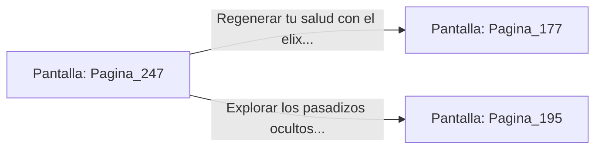

# 📺 Nodo Pantalla: `Pagina_247`

[[Index|⬅️ Índice]] | Fichero Origen: [[sample_eligejuego-code_capitulo_13_mpl|📄 sample/eligejuego-code/capitulo_13.mpl]]

**Narrativa y Encabezado:**
> PÁGINA 247: EL DORMITORIO DEL ARCHIMAGO
> 
> Ingresas a las dependencias privadas del antiguo Archimago. La estancia está sumida en la penumbra, revestida de tapices desgastados y anaqueles llenos de frascos con elixir de salud.
> 
> En un escritorio de roble encuentras una carta manuscrita que relata los verdaderos planes de Malakor para usar el Núcleo de Éter y reescribir el destino de Aethelgard.
> 
> Guardas el documento en tu memoria óptica y consumes uno de los elixires para regenerar tu vitalidad antes de dirigirte a la Sala del Trono.

## 📋 Desglose de Instrucciones de Opciones
### `OPCION "Regenerar tu salud con el elixir e ir a la Sala del Trono" CON_ACCION TRANSICIONAR_A Pagina_177`
* **Instrucción:** `OPCION` *(Manual: Mapea una entrada o botón interactivo de usuario. Vincular una acción como la invocación de una función C1, un método C2 o una transición C3.)*
* **Efecto de Control:** Dispara `TRANSICIONAR_A` hacia [[Pantalla_Pagina_177|📺 Pagina_177]]
### `OPCION "Explorar los pasadizos ocultos tras los tapices desgastados" CON_ACCION TRANSICIONAR_A Pagina_195`
* **Instrucción:** `OPCION` *(Manual: Mapea una entrada o botón interactivo de usuario. Vincular una acción como la invocación de una función C1, un método C2 o una transición C3.)*
* **Efecto de Control:** Dispara `TRANSICIONAR_A` hacia [[Pantalla_Pagina_195|📺 Pagina_195]]

## 📊 Diagrama de Flujo e Interacción (Mermaid)

