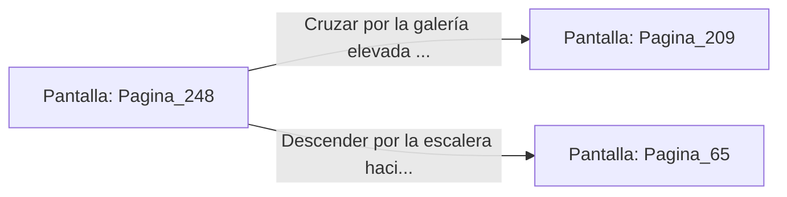

# 📺 Nodo Pantalla: `Pagina_248`

[[Index|⬅️ Índice]] | Fichero Origen: [[sample_eligejuego-code_capitulo_13_mpl|📄 sample/eligejuego-code/capitulo_13.mpl]]

**Narrativa y Encabezado:**
> PÁGINA 248: EL PASAJE TRAS LOS TAPICES
> 
> Descorres los viejos tapices y descubres un angosto pasillo de piedra pulida que asciende en espiral iluminado por runas de cobre.
> 
> Al coronar la subida te encuentras en la galería elevada de los balcones de la catedral.

## 📋 Desglose de Instrucciones de Opciones
### `OPCION "Cruzar por la galería elevada de los balcones de la catedral" CON_ACCION TRANSICIONAR_A Pagina_209`
* **Instrucción:** `OPCION` *(Manual: Mapea una entrada o botón interactivo de usuario. Vincular una acción como la invocación de una función C1, un método C2 o una transición C3.)*
* **Efecto de Control:** Dispara `TRANSICIONAR_A` hacia [[Pantalla_Pagina_209|📺 Pagina_209]]
### `OPCION "Descender por la escalera hacia la sala de los generadores" CON_ACCION TRANSICIONAR_A Pagina_65`
* **Instrucción:** `OPCION` *(Manual: Mapea una entrada o botón interactivo de usuario. Vincular una acción como la invocación de una función C1, un método C2 o una transición C3.)*
* **Efecto de Control:** Dispara `TRANSICIONAR_A` hacia [[Pantalla_Pagina_65|📺 Pagina_65]]

## 📊 Diagrama de Flujo e Interacción (Mermaid)

