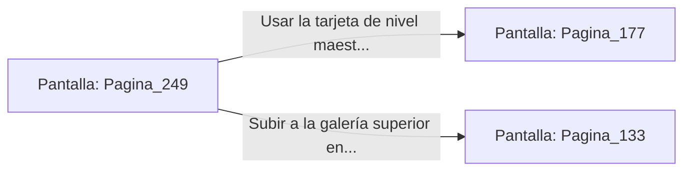

# 📺 Nodo Pantalla: `Pagina_249`

[[Index|⬅️ Índice]] | Fichero Origen: [[sample_eligejuego-code_capitulo_13_mpl|📄 sample/eligejuego-code/capitulo_13.mpl]]

**Narrativa y Encabezado:**
> PÁGINA 249: LA ANTESALA DEL TRONO
> 
> Llegas a la monumental Antesala del Trono. Filas de columnas de mármol negro con vetas doradas sostienen una bóveda acristalada desde la que se observa la tormenta de éter exterior.
> 
> En el fondo de la estancia, flanqueada por dos estatuas gigantescas de guardianes biomecánicos, se halla la doble puerta blindada que da acceso directo a la Sala del Trono del Inquisidor.
> 
> Tienes la opción de usar tu tarjeta de nivel maestro para abrir la puerta blindada o subir a la galería superior para buscar un acceso por el techo.

## 📋 Desglose de Instrucciones de Opciones
### `OPCION "Usar la tarjeta de nivel maestro para abrir la puerta blindada" CON_ACCION TRANSICIONAR_A Pagina_177`
* **Instrucción:** `OPCION` *(Manual: Mapea una entrada o botón interactivo de usuario. Vincular una acción como la invocación de una función C1, un método C2 o una transición C3.)*
* **Efecto de Control:** Dispara `TRANSICIONAR_A` hacia [[Pantalla_Pagina_177|📺 Pagina_177]]
### `OPCION "Subir a la galería superior en busca de un acceso por el techo" CON_ACCION TRANSICIONAR_A Pagina_133`
* **Instrucción:** `OPCION` *(Manual: Mapea una entrada o botón interactivo de usuario. Vincular una acción como la invocación de una función C1, un método C2 o una transición C3.)*
* **Efecto de Control:** Dispara `TRANSICIONAR_A` hacia [[Pantalla_Pagina_133|📺 Pagina_133]]

## 📊 Diagrama de Flujo e Interacción (Mermaid)

