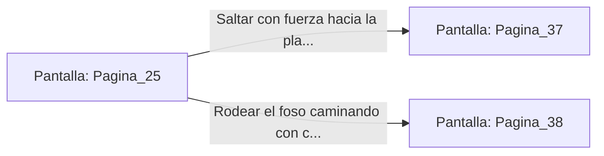

# 📺 Nodo Pantalla: `Pagina_25`

[[Index|⬅️ Índice]] | Fichero Origen: [[sample_eligejuego-code_capitulo_02_mpl|📄 sample/eligejuego-code/capitulo_02.mpl]]

**Narrativa y Encabezado:**
> PÁGINA 25: EL FOSO DE RESIDUOS
> 
> Te adentras en el foso de drenaje. Las paredes están cubiertas por una capa de moho fosforescente que emite un resplandor esmeralda, suficiente para orientarte en la penumbra. El suelo está resbaladizo por los sedimentos orgánicos procesados por la antigua ciudadela.
> 
> A mitad de trayecto, el túnel se abre en una enorme cavidad de filtrado. En el centro de la piscina de decantación flota una plataforma mecánica suspendida por cadenas de hierro que parecen a punto de romperse.
> 
> Tienes la opción de saltar hacia la plataforma suspendida para alcanzar la orilla opuesta o rodear el Foso caminando por la estrecha cornisa perimetral.

## 📋 Desglose de Instrucciones de Opciones
### `OPCION "Saltar con fuerza hacia la plataforma suspendida sobre el foso" CON_ACCION TRANSICIONAR_A Pagina_37`
* **Instrucción:** `OPCION` *(Manual: Mapea una entrada o botón interactivo de usuario. Vincular una acción como la invocación de una función C1, un método C2 o una transición C3.)*
* **Efecto de Control:** Dispara `TRANSICIONAR_A` hacia [[Pantalla_Pagina_37|📺 Pagina_37]]
### `OPCION "Rodear el foso caminando con cuidado por la cornisa resbaladiza" CON_ACCION TRANSICIONAR_A Pagina_38`
* **Instrucción:** `OPCION` *(Manual: Mapea una entrada o botón interactivo de usuario. Vincular una acción como la invocación de una función C1, un método C2 o una transición C3.)*
* **Efecto de Control:** Dispara `TRANSICIONAR_A` hacia [[Pantalla_Pagina_38|📺 Pagina_38]]

## 📊 Diagrama de Flujo e Interacción (Mermaid)

