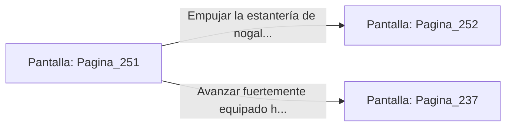

# 📺 Nodo Pantalla: `Pagina_251`

[[Index|⬅️ Índice]] | Fichero Origen: [[sample_eligejuego-code_capitulo_14_mpl|📄 sample/eligejuego-code/capitulo_14.mpl]]

**Narrativa y Encabezado:**
> PÁGINA 251: EL DESARME DEL GRIMORIO
> 
> Te inclinas sobre la mesa de lecturas de mármol negro y memorizas las secuencias rúnicas del grimorio. Las palabras clave se graban en la memoria de tu Brazal de Convergencia, generando un código de interferencia capaz de anular la lealtad mística de la Guardia Personal de Malakor.
> 
> Al registrar los compartimentos del escritorio, encuentras además una Célula de Inducción Cuántica con la que reabasteces tus reservas energéticas por completo. Sientes cómo el potencial ofensivo de tu equipo alcanza su nivel óptimo.
> 
> Con las secuencias registradas y el equipo a punto, debes decidir si tomar el pasaje secreto tras la estantería o dirigirte al Vestíbulo de las Sombras.

## 📋 Desglose de Instrucciones de Opciones
### `OPCION "Empujar la estantería de nogal para tomar el pasaje secreto" CON_ACCION TRANSICIONAR_A Pagina_252`
* **Instrucción:** `OPCION` *(Manual: Mapea una entrada o botón interactivo de usuario. Vincular una acción como la invocación de una función C1, un método C2 o una transición C3.)*
* **Efecto de Control:** Dispara `TRANSICIONAR_A` hacia [[Pantalla_Pagina_252|📺 Pagina_252]]
### `OPCION "Avanzar fuertemente equipado hacia el Vestíbulo de las Sombras" CON_ACCION TRANSICIONAR_A Pagina_237`
* **Instrucción:** `OPCION` *(Manual: Mapea una entrada o botón interactivo de usuario. Vincular una acción como la invocación de una función C1, un método C2 o una transición C3.)*
* **Efecto de Control:** Dispara `TRANSICIONAR_A` hacia [[Pantalla_Pagina_237|📺 Pagina_237]]

## 📊 Diagrama de Flujo e Interacción (Mermaid)

