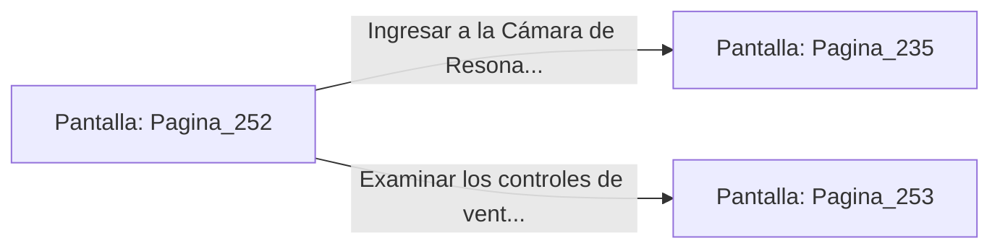

# 📺 Nodo Pantalla: `Pagina_252`

[[Index|⬅️ Índice]] | Fichero Origen: [[sample_eligejuego-code_capitulo_14_mpl|📄 sample/eligejuego-code/capitulo_14.mpl]]

**Narrativa y Encabezado:**
> PÁGINA 252: EL PASAJE OCULTO DE NOGAL
> 
> Empujas el lateral de la estantería de nogal petrificado, la cual se desplaza en silencio sobre rieles de bronce para revelar una estrecha rampa de piedra que asciende en espiral.
> 
> Avanzas por la rampa evitando los sensores de movimiento hasta alcanzar una escotilla superior que desemboca justo detrás de la Cámara de Resonancia.

## 📋 Desglose de Instrucciones de Opciones
### `OPCION "Ingresar a la Cámara de Resonancia por la escotilla posterior" CON_ACCION TRANSICIONAR_A Pagina_235`
* **Instrucción:** `OPCION` *(Manual: Mapea una entrada o botón interactivo de usuario. Vincular una acción como la invocación de una función C1, un método C2 o una transición C3.)*
* **Efecto de Control:** Dispara `TRANSICIONAR_A` hacia [[Pantalla_Pagina_235|📺 Pagina_235]]
### `OPCION "Examinar los controles de ventilación de la rampa" CON_ACCION TRANSICIONAR_A Pagina_253`
* **Instrucción:** `OPCION` *(Manual: Mapea una entrada o botón interactivo de usuario. Vincular una acción como la invocación de una función C1, un método C2 o una transición C3.)*
* **Efecto de Control:** Dispara `TRANSICIONAR_A` hacia [[Pantalla_Pagina_253|📺 Pagina_253]]

## 📊 Diagrama de Flujo e Interacción (Mermaid)

