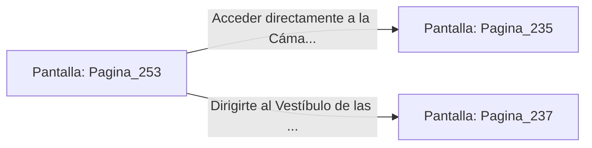

# 📺 Nodo Pantalla: `Pagina_253`

[[Index|⬅️ Índice]] | Fichero Origen: [[sample_eligejuego-code_capitulo_14_mpl|📄 sample/eligejuego-code/capitulo_14.mpl]]

**Narrativa y Encabezado:**
> PÁGINA 253: EL PASO DE LAS ESTATUAS
> 
> Avanzas con ritmo constante calculando con precisión los intervalos de parpadeo de los ojos de bronce. Cruzando cada tramo en el segundo exacto de sombra, dejas atrás la galería sin que los sensores kinetos activen las defensas del palacio.
> 
> Alcanzas la puerta acorazada del extremo opuesto, donde un panel secundario permite descargar las frecuencias de resonancia del sector para recargar los escudos refractarios de tu Brazal.
> 
> Con las defensas reforzadas, pones rumbo hacia la Cámara de Resonancia o hacia el Vestíbulo de las Sombras.

## 📋 Desglose de Instrucciones de Opciones
### `OPCION "Acceder directamente a la Cámara de Resonancia" CON_ACCION TRANSICIONAR_A Pagina_235`
* **Instrucción:** `OPCION` *(Manual: Mapea una entrada o botón interactivo de usuario. Vincular una acción como la invocación de una función C1, un método C2 o una transición C3.)*
* **Efecto de Control:** Dispara `TRANSICIONAR_A` hacia [[Pantalla_Pagina_235|📺 Pagina_235]]
### `OPCION "Dirigirte al Vestíbulo de las Sombras" CON_ACCION TRANSICIONAR_A Pagina_237`
* **Instrucción:** `OPCION` *(Manual: Mapea una entrada o botón interactivo de usuario. Vincular una acción como la invocación de una función C1, un método C2 o una transición C3.)*
* **Efecto de Control:** Dispara `TRANSICIONAR_A` hacia [[Pantalla_Pagina_237|📺 Pagina_237]]

## 📊 Diagrama de Flujo e Interacción (Mermaid)

