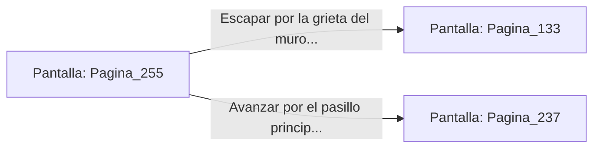

# 📺 Nodo Pantalla: `Pagina_255`

[[Index|⬅️ Índice]] | Fichero Origen: [[sample_eligejuego-code_capitulo_14_mpl|📄 sample/eligejuego-code/capitulo_14.mpl]]

**Narrativa y Encabezado:**
> PÁGINA 255: LA DESESTABILIZACIÓN DEL DIAPASÓN
> 
> Alineas la mira de tu lanzagranadas de pulso y disparas una carga electromagnética directamente contra el centro del gran diapasón. La onda de choque hace vibrar el metal con un estruendo ensordecedor que agrieta la mampostería de la bóveda.
> 
> La frecuencia de estabilidad de la Torre del Trono colapsa de inmediato, haciendo que los escudos refractarios de la Sala del Trono parpadeen y pierdan el treinta por ciento de su capacidad defensiva.
> 
> Aprovechando el caos generado por la vibración, abandonas la estancia por la grieta del muro o por el pasillo principal hacia el Vestíbulo de las Sombras.

## 📋 Desglose de Instrucciones de Opciones
### `OPCION "Escapar por la grieta del muro hacia el nivel de la cúpula" CON_ACCION TRANSICIONAR_A Pagina_133`
* **Instrucción:** `OPCION` *(Manual: Mapea una entrada o botón interactivo de usuario. Vincular una acción como la invocación de una función C1, un método C2 o una transición C3.)*
* **Efecto de Control:** Dispara `TRANSICIONAR_A` hacia [[Pantalla_Pagina_133|📺 Pagina_133]]
### `OPCION "Avanzar por el pasillo principal hacia el Vestíbulo de las Sombras" CON_ACCION TRANSICIONAR_A Pagina_237`
* **Instrucción:** `OPCION` *(Manual: Mapea una entrada o botón interactivo de usuario. Vincular una acción como la invocación de una función C1, un método C2 o una transición C3.)*
* **Efecto de Control:** Dispara `TRANSICIONAR_A` hacia [[Pantalla_Pagina_237|📺 Pagina_237]]

## 📊 Diagrama de Flujo e Interacción (Mermaid)

