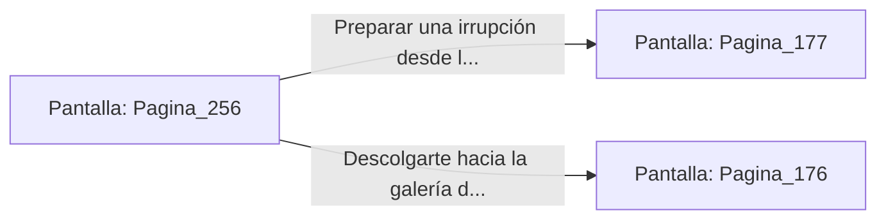

# 📺 Nodo Pantalla: `Pagina_256`

[[Index|⬅️ Índice]] | Fichero Origen: [[sample_eligejuego-code_capitulo_14_mpl|📄 sample/eligejuego-code/capitulo_14.mpl]]

**Narrativa y Encabezado:**
> PÁGINA 256: LA GRIETA DE LA CÚPULA
> 
> Te cuelas por la grieta abierta en la mampostería de la Cámara de Resonancia. El angosto túnel de servicio te conduce directamente a las vigas estructurales que sostienen la cúpula acristalada del palacio.
> 
> Desde esta posición elevada dominas la vista completa de la Sala del Trono y divisas la posición exacta del Inquisidor Malakor.

## 📋 Desglose de Instrucciones de Opciones
### `OPCION "Preparar una irrupción desde las vigas de la cúpula" CON_ACCION TRANSICIONAR_A Pagina_177`
* **Instrucción:** `OPCION` *(Manual: Mapea una entrada o botón interactivo de usuario. Vincular una acción como la invocación de una función C1, un método C2 o una transición C3.)*
* **Efecto de Control:** Dispara `TRANSICIONAR_A` hacia [[Pantalla_Pagina_177|📺 Pagina_177]]
### `OPCION "Descolgarte hacia la galería de los balcones laterales" CON_ACCION TRANSICIONAR_A Pagina_176`
* **Instrucción:** `OPCION` *(Manual: Mapea una entrada o botón interactivo de usuario. Vincular una acción como la invocación de una función C1, un método C2 o una transición C3.)*
* **Efecto de Control:** Dispara `TRANSICIONAR_A` hacia [[Pantalla_Pagina_176|📺 Pagina_176]]

## 📊 Diagrama de Flujo e Interacción (Mermaid)

