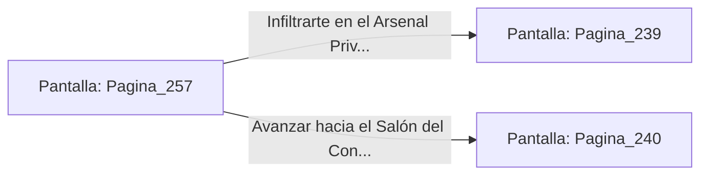

# 📺 Nodo Pantalla: `Pagina_257`

[[Index|⬅️ Índice]] | Fichero Origen: [[sample_eligejuego-code_capitulo_14_mpl|📄 sample/eligejuego-code/capitulo_14.mpl]]

**Narrativa y Encabezado:**
> PÁGINA 257: SIGILO EN EL VESTÍBULO
> 
> Activas el camuflaje térmico y te deslizas sigilosamente entre las sombras de las columnas de basalto. Los cuatro Ejecutores Umbrales patrullan la nave central sin percibir tu presencia gracias al velo de invisibilidad de tu equipo.
> 
> Alcanzas la escalera de acceso a las galerías superiores sin levantar sospechas. Desde la balconada divisas la puerta acorazada del Arsenal Privado de Malakor y el acceso al Salón del Consejo.
> 
> Puedes colarte en el Arsenal Privado para apoderarte de armamento avanzado o continuar hacia el Salón del Consejo.

## 📋 Desglose de Instrucciones de Opciones
### `OPCION "Infiltrarte en el Arsenal Privado de Malakor" CON_ACCION TRANSICIONAR_A Pagina_239`
* **Instrucción:** `OPCION` *(Manual: Mapea una entrada o botón interactivo de usuario. Vincular una acción como la invocación de una función C1, un método C2 o una transición C3.)*
* **Efecto de Control:** Dispara `TRANSICIONAR_A` hacia [[Pantalla_Pagina_239|📺 Pagina_239]]
### `OPCION "Avanzar hacia el Salón del Consejo" CON_ACCION TRANSICIONAR_A Pagina_240`
* **Instrucción:** `OPCION` *(Manual: Mapea una entrada o botón interactivo de usuario. Vincular una acción como la invocación de una función C1, un método C2 o una transición C3.)*
* **Efecto de Control:** Dispara `TRANSICIONAR_A` hacia [[Pantalla_Pagina_240|📺 Pagina_240]]

## 📊 Diagrama de Flujo e Interacción (Mermaid)

