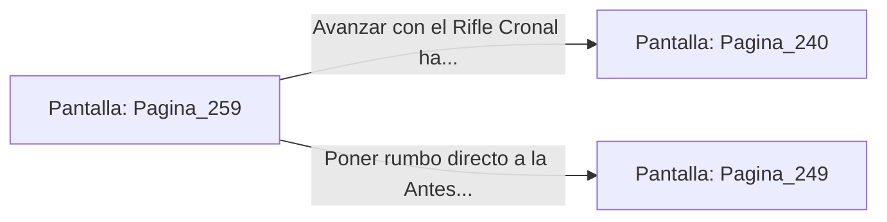

# 📺 Nodo Pantalla: `Pagina_259`

[[Index|⬅️ Índice]] | Fichero Origen: [[sample_eligejuego-code_capitulo_14_mpl|📄 sample/eligejuego-code/capitulo_14.mpl]]

**Narrativa y Encabezado:**
> PÁGINA 259: EL RIFLE CRONAL EN TU PODER
> 
> Conectas tu Brazal de Convergencia al puerto de datos de la peana electrificada e inyectas el código de anulación. El campo de inducción se apaga con un suspiro térmico, liberando el Rifle de Pulso Cronal y el Escudo Deflector.
> 
> Equipas el Rifle Cronal en tu arnés. Esta reliquia tecnológica dispara proyectiles de aceleración temporal capaces de perforar la armadura de fase de Malakor e ignorar los campos de fuerza convencionales.
> 
> Con esta poderosa arma en tu poder, pones rumbo definitivo al Salón del Consejo o a la Antesala del Trono.

## 📋 Desglose de Instrucciones de Opciones
### `OPCION "Avanzar con el Rifle Cronal hacia el Salón del Consejo" CON_ACCION TRANSICIONAR_A Pagina_240`
* **Instrucción:** `OPCION` *(Manual: Mapea una entrada o botón interactivo de usuario. Vincular una acción como la invocación de una función C1, un método C2 o una transición C3.)*
* **Efecto de Control:** Dispara `TRANSICIONAR_A` hacia [[Pantalla_Pagina_240|📺 Pagina_240]]
### `OPCION "Poner rumbo directo a la Antesala del Trono" CON_ACCION TRANSICIONAR_A Pagina_249`
* **Instrucción:** `OPCION` *(Manual: Mapea una entrada o botón interactivo de usuario. Vincular una acción como la invocación de una función C1, un método C2 o una transición C3.)*
* **Efecto de Control:** Dispara `TRANSICIONAR_A` hacia [[Pantalla_Pagina_249|📺 Pagina_249]]

## 📊 Diagrama de Flujo e Interacción (Mermaid)

