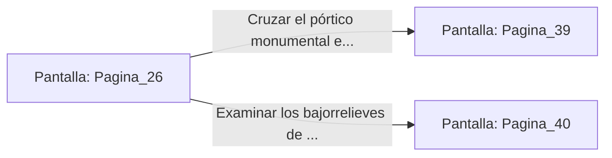

# 📺 Nodo Pantalla: `Pagina_26`

[[Index|⬅️ Índice]] | Fichero Origen: [[sample_eligejuego-code_capitulo_02_mpl|📄 sample/eligejuego-code/capitulo_02.mpl]]

**Narrativa y Encabezado:**
> PÁGINA 26: LA ESCALERA DE ROCA VIVA
> 
> Subes peldaño a peldaño dejando atrás la humedad de las catacumbas. La piedra tallada a mano da paso progresivamente a sillares perfectamente labrados y decorados con bajorrelieves de batallas astronómicas.
> 
> Al coronar el tramo superior, te encuentras frente a un pórtico monumental de mármol negro que da acceso al Claustro de los Observadores.

## 📋 Desglose de Instrucciones de Opciones
### `OPCION "Cruzar el pórtico monumental e ingresar al Claustro" CON_ACCION TRANSICIONAR_A Pagina_39`
* **Instrucción:** `OPCION` *(Manual: Mapea una entrada o botón interactivo de usuario. Vincular una acción como la invocación de una función C1, un método C2 o una transición C3.)*
* **Efecto de Control:** Dispara `TRANSICIONAR_A` hacia [[Pantalla_Pagina_39|📺 Pagina_39]]
### `OPCION "Examinar los bajorrelieves de las paredes en busca de pasajes ocultos" CON_ACCION TRANSICIONAR_A Pagina_40`
* **Instrucción:** `OPCION` *(Manual: Mapea una entrada o botón interactivo de usuario. Vincular una acción como la invocación de una función C1, un método C2 o una transición C3.)*
* **Efecto de Control:** Dispara `TRANSICIONAR_A` hacia [[Pantalla_Pagina_40|📺 Pagina_40]]

## 📊 Diagrama de Flujo e Interacción (Mermaid)

